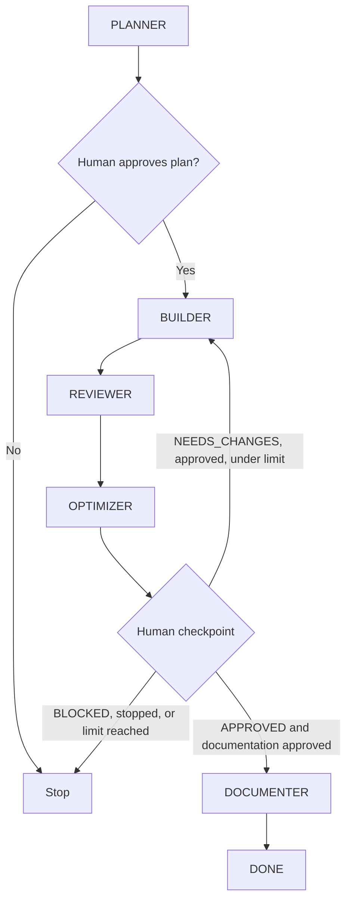

# Agent Harness

The normative policy, project restrictions, permissions, and approval rules live in [AGENTS.md](../../AGENTS.md). This file describes the plan contract and how the harness is operated; it is not a second policy source.

## Plan Layout

Each implementation plan is stored in `.github/plans/<ID>/`:

| Artifact | Purpose | Owner |
| --- | --- | --- |
| `00-*.md`, `01-*.md`, ... | Ordered steps with objective, scope, verifiable acceptance criteria, and proof | PLANNER |
| `STATUS.md` | Current state/cycle, UTC agent windows, commands/results, blockers, and documentation change list; full detail only for the current and previous cycle, older `APPROVED` cycles collapsed to a summary index | PLANNER initializes; BUILDER, REVIEWER, DOCUMENTER update within scope |
| `STATUS-archive.md` | Verbatim detail of collapsed `APPROVED` cycles | BUILDER |
| `REVIEW.md` | Review evidence, findings, and verdict | PLANNER initializes; REVIEWER maintains |
| `usage/BUILDER.md` | Append-only per-cycle BUILDER usage rows | BUILDER |
| `usage/REVIEWER.md` | Append-only per-cycle REVIEWER usage rows | REVIEWER |
| `OPTIMIZATION.md` | Evidence and proposals, organized by cycle; full detail only for the 2 most recent cycles, older ones collapsed to a summary row | OPTIMIZER |

Plan steps follow acceptance tests, unit tests, then refactor and revalidation. Open requirements are questions, not assumptions. Required table columns and role-specific edit permissions are defined in [AGENTS.md](../../AGENTS.md).

## Workflow

ORCHESTRATOR owns the sequence and pauses at both approval points. Each development cycle always contains BUILDER, REVIEWER, and OPTIMIZER in that order. A cycle is not repeated and documentation is not started until the operator explicitly approves at the checkpoint. The repository limit is six cycles.

## States

| State | Meaning |
| --- | --- |
| `PLANNED` | PLANNER initialized the plan; awaiting human plan approval |
| `READY_FOR_REVIEW` | BUILDER finished planned work and recorded evidence |
| `NEEDS_CHANGES` | REVIEWER found a blocking issue or missing evidence; awaiting human decision |
| `APPROVED` | REVIEWER demonstrated every criterion; awaiting human documentation decision |
| `BLOCKED` | A prerequisite or unresolved issue prevents valid progress; stop the flow |
| `DONE` | DOCUMENTER completed approved documentation after human authorization |

## Roles and Records

- PLANNER creates plan steps and tracking files; no product changes.
- BUILDER implements only approved scope and records its own usage row.
- REVIEWER independently examines the full diff and evidence, records the verdict, and records its own usage row; it does not fix product code.
- OPTIMIZER analyzes cycle evidence, distinguishes measured from estimated usage, and proposes changes. It records only explicitly approved proposals in shared memories.
- DOCUMENTER records only demonstrated behavior in functional and technical feature documentation after explicit approval.
- ORCHESTRATOR coordinates, reports, and waits; it edits no files and makes no approval decision.

`usage/BUILDER.md` and `usage/REVIEWER.md` use one append-only row per cycle. Dashboard data is optional; when available, OPTIMIZER uses `tools/usage-slice.mjs` rather than reading JSONL directly. Copilot events may be session aggregates and must not be divided among roles. Shared approved optimization history lives in `MEMORIES.md`, outside any plan. `MEMORIES.md` is append-only except for hierarchical compaction: rows that are `aplicada`/`revertida` with a final effect are collapsed to a summary table at its top, and their full rows move verbatim to `MEMORIES-archive.md` (see [AGENTS.md](../../AGENTS.md)).

## Entry Prompts

| Prompt | Agent | Input |
| --- | --- | --- |
| `/harness-plan` | PLANNER | `planId`, `specs` |
| `/harness-build` | BUILDER | `planPath` |
| `/harness-review` | REVIEWER | `planPath` |
| `/harness-optimize` | OPTIMIZER | `planPath` |
| `/harness-document` | DOCUMENTER | `planPath` |
| `/harness-run` | ORCHESTRATOR | `planPath` or `specs`, `maxCycles` |

Standalone prompts are for explicit manual, single-role requests. Normal feature work uses `/harness-run` so human checkpoints cannot be bypassed accidentally.

## Claude Code

Same plans, states, `MEMORIES.md` and `tools/usage-slice.mjs` as Copilot. Claude-specific differences live in [CLAUDE.md](../../CLAUDE.md), which imports `AGENTS.md`.

| Command | Role | Input |
| --- | --- | --- |
| `/harness-plan` | `planner` subagent | `<ID> <specs>` |
| `/harness-build` | `builder` subagent | `<plan folder>` |
| `/harness-review` | `reviewer` subagent | `<plan folder>` |
| `/harness-optimize` | `optimizer` subagent | `<plan folder> [approved/rejected IDs]` |
| `/harness-document` | `documenter` subagent | `<plan folder>` |
| `/harness-run` | ORCHESTRATOR (main session) | `<plan folder or specs> [max cycles]` |

- Subagents (`.claude/agents/`) cannot spawn subagents, so the ORCHESTRATOR runs in the main session and each checkpoint ends its turn.
- Subagents write `estimado`/`n/a` usage rows; OPTIMIZER adds measured data (`medido:token-consumer`, `medido:agent-result`, `medido:transcript`) to `OPTIMIZATION.md`.
- `.claude/settings.json` denies `git commit`/`git push` and edits to the generated client files, and allows running `usage-slice`.