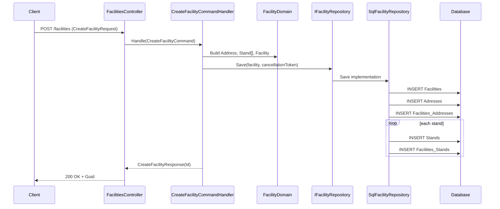

# Facility Create Feature

## Overview (Descripcion General)

This feature creates a facility through the API endpoint POST /api/v{version}/facilities. The controller maps the incoming request into a command, the command handler composes domain objects (facility, address, and optional stands), and the repository persists the aggregate and relation tables.

## Sequence/Architecture Diagram (Mermaid)



## Methods & Properties Table (Tabla de Metodos/Propiedades)

| Component | Member | Signature / Type | Return | Description |
|---|---|---|---|---|
| FacilitiesController | Create | Task<Guid> Create([FromBody] CreateFacilityRequest request) | Task<Guid> | Maps request to command and returns created facility Id. |
| CreateFacilityRequest | Name | string | string | Facility name. |
| CreateFacilityRequest | Active | bool | bool | Active flag for facility state. |
| CreateFacilityRequest | BuildDate | DateTime | DateTime | Construction/build date. |
| CreateFacilityRequest | Type | FacilityType | FacilityType | Facility kind: Stadium, Arena, Pitch, Training. |
| CreateFacilityRequest | Capacity | int | int | Total supported capacity. |
| CreateFacilityRequest | Address | CreateFacilityAddressRequest | CreateFacilityAddressRequest | Required address payload. |
| CreateFacilityRequest | Stands | List<CreateFacilityStandRequest>? | List<CreateFacilityStandRequest>? | Optional stand list, max length 4. |
| CreateFacilityAddressRequest | Street | string | string | Street name. |
| CreateFacilityAddressRequest | StreetNumber | string | string | Street number. |
| CreateFacilityAddressRequest | PostalCode | string | string | Postal code. |
| CreateFacilityAddressRequest | City | string | string | City. |
| CreateFacilityAddressRequest | Region | string | string | Region/state. |
| CreateFacilityAddressRequest | Country | string | string | Country. |
| CreateFacilityStandRequest | StandName | string | string | Stand display name. |
| CreateFacilityStandRequest | StandCapacity | int | int | Capacity for a stand. |
| CreateFacilityCommand | Record | (string Name, bool Active, DateTime BuildDate, FacilityType Type, int Capacity, CreateFacilityAddressCommand Address, List<CreateFacilityStandCommand>? Stands) | ICommand<CreateFacilityResponse> | Command contract for creation use case. |
| CreateFacilityAddressCommand | Record | (string Street, string StreetNumber, string PostalCode, string City, string Region, string Country) | n/a | Value payload for address mapping. |
| CreateFacilityStandCommand | Record | (string StandName, int StandCapacity) | n/a | Value payload for stand mapping. |
| CreateFacilityResponse | Record | (Guid Id) | n/a | Result containing created facility Id. |
| CreateFacilityCommandHandler | Handle | Task<CreateFacilityResponse> Handle(CreateFacilityCommand command, CancellationToken cancellationToken) | Task<CreateFacilityResponse> | Creates domain aggregate, calls repository save, returns Id. |
| IFacilityRepository | Save | Task Save(Facility facility, CancellationToken cancellationToken) | Task | Abstraction for facility persistence. |
| SqlFacilityRepository | Save | Task Save(Facility facility, CancellationToken cancellationToken) | Task | Persists facility, address, relation rows, and stand rows. |
| Facility | Id | Guid | Guid | Facility primary identifier. |
| Facility | Name | string | string | Facility name. |
| Facility | Active | bool | bool | Active status. |
| Facility | BuildDate | DateTime | DateTime | Build date. |
| Facility | Type | FacilityType | FacilityType | Facility classification enum value. |
| Facility | Capacity | int | int | Capacity value for validations/business use. |
| Facility | Address | Address | Address | Required address object, validated non-null. |
| Facility | Stands | List<Stand> | List<Stand> | Stand collection validated to max 4 items. |

## Dependencies (Dependencias)

- ICommandHandler<CreateFacilityCommand, CreateFacilityResponse>
- IFacilityRepository
- IDatabaseConnectionProvider
- ASP.NET Core MVC attributes and binding
- Domain model types: Facility, Address, Stand, FacilityType

## Usage Examples (Ejemplos de Uso)

### HTTP Request

```http
POST /api/v1/facilities HTTP/1.1
Content-Type: application/json

{
  "name": "North Arena",
  "active": true,
  "buildDate": "2015-06-20T00:00:00Z",
  "type": "Arena",
  "capacity": 42000,
  "address": {
    "street": "Main Avenue",
    "streetNumber": "123",
    "postalCode": "28001",
    "city": "Madrid",
    "region": "Madrid",
    "country": "Spain"
  },
  "stands": [
    { "standName": "East", "standCapacity": 10000 },
    { "standName": "West", "standCapacity": 12000 }
  ]
}
```

### Handler Consumption

```csharp
var command = new CreateFacilityCommand(
    "North Arena",
    true,
    new DateTime(2015, 6, 20),
    FacilityType.Arena,
    42000,
    new CreateFacilityAddressCommand("Main Avenue", "123", "28001", "Madrid", "Madrid", "Spain"),
    [
        new CreateFacilityStandCommand("East", 10000),
        new CreateFacilityStandCommand("West", 12000)
    ]);

CreateFacilityResponse result = await createFacilityCommandHandler.Handle(command, cancellationToken);
Guid createdId = result.Id;
```
