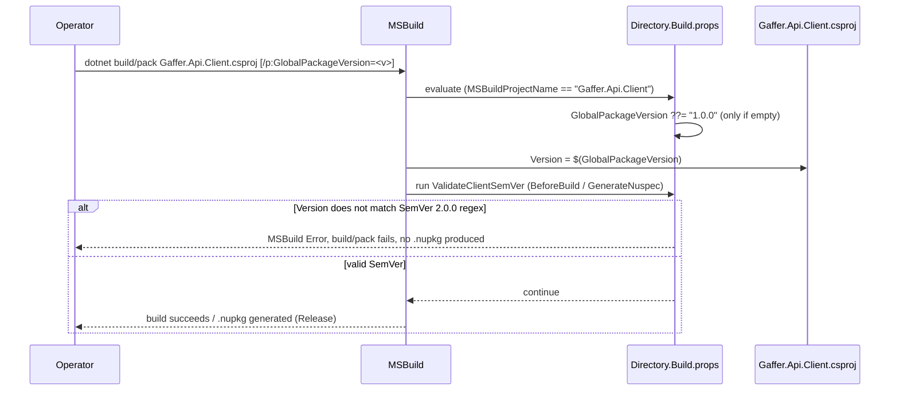

# Gaffer.Api.Client Versioning — Technical

## Overview

`Gaffer.Api.Client` (the NSwag-generated client package) is versioned with Semantic Versioning 2.0.0, enforced at build/pack time. A root `Directory.Build.props` — imported by every project in the solution, but with all its content conditioned on `'$(MSBuildProjectName)' == 'Gaffer.Api.Client'` — sets `GlobalPackageVersion` to `1.0.0` by default (only when not already provided, so `/p:GlobalPackageVersion=<version>` keeps working as an override) and declares a `ValidateClientSemVer` target that runs `BeforeTargets="BeforeBuild;GenerateNuspec"`. The target raises an MSBuild error and fails the build/pack if `$(Version)` (which `Gaffer.Api.Client.csproj` sets to `$(GlobalPackageVersion)`) does not match the official SemVer 2.0.0 regex. `Gaffer.Api/nswag.json`'s `infoVersion` is kept aligned with the same value by convention (both are `1.0.0` as of this change) and must be updated by hand alongside a version bump. The condition means the other three projects (`Gaffer.Api`, `Gaffer.Api.Migrations`, `Gaffer.Api.Tests`) import the file without picking up any property or target — verified by comparing their MSBuild properties with and without the props file.

### Who it is for

- Whoever regenerates and publishes `Gaffer.Api.Client` after an API contract change.
- Consumers of the client package who need to know what a version bump means.

## Rule

| Change | Version bump |
|---|---|
| Incompatible contract change (status codes, types, wire format, removal) | MAJOR |
| Backward-compatible addition (new endpoint, new optional property) | MINOR |
| Fix with no contract change | PATCH |

## Sequence Diagram



## Methods & Properties Table

| File | Member | Description |
|---|---|---|
| `Directory.Build.props` (root) | `PropertyGroup` (`Gaffer.Api.Client` only) | `GlobalPackageVersion` defaults to `1.0.0` only if not already set by the caller. |
| `Directory.Build.props` (root) | `Target ValidateClientSemVer` | `BeforeTargets="BeforeBuild;GenerateNuspec"`, condition `MSBuildProjectName == 'Gaffer.Api.Client'`; `<Error>` if `$(Version)` fails the official SemVer 2.0.0 regex (`MAJOR.MINOR.PATCH[-prerelease][+build]`). Covers `dotnet build`, `dotnet pack`, and `dotnet pack --no-build` (`GenerateNuspec`). |
| `Gaffer.Api.Client/Gaffer.Api.Client.csproj` | `<Version>` | `$(GlobalPackageVersion)`; unchanged in this plan — the versioning logic lives entirely in `Directory.Build.props`. |
| `Gaffer.Api/nswag.json` | `infoVersion` | `"1.0.0"`; must be updated to match `GlobalPackageVersion` whenever the client version changes, so the generated OpenAPI document's declared version tracks the package version. |

## Dependencies

- No new `PackageReference` or MSBuild `Import` was added; `Directory.Build.props` only adds the property and target described above, scoped to `Gaffer.Api.Client`.
- Contract changes that require a version bump under this rule: see [`api-contract-and-access.md`](./api-contract-and-access.md) (this plan's own MAJOR-worthy change: `201` + `Location` on create, enums as text).
- `.github/doc/common/dev-stack.md`, "Build and Packaging Notes" documents this rule at the stack level.

## Usage Examples

### Default version (no override)

```bash
dotnet build Gaffer.Api.Client/Gaffer.Api.Client.csproj
# Version = PackageVersion = 1.0.0
```

### Explicit version override

```bash
dotnet build Gaffer.Api.Client/Gaffer.Api.Client.csproj -p:GlobalPackageVersion=2.3.4
dotnet pack Gaffer.Api.Client/Gaffer.Api.Client.csproj -c Release -p:GlobalPackageVersion=2.3.4
```

### Invalid version is rejected before packaging

```bash
dotnet build Gaffer.Api.Client/Gaffer.Api.Client.csproj -p:GlobalPackageVersion=1.0
# error: Gaffer.Api.Client version '1.0' is not a valid Semantic Version 2.0.0 (MAJOR.MINOR.PATCH[-prerelease][+build], e.g. 1.0.0).
```

### Other projects are unaffected

```bash
dotnet msbuild Gaffer.Api/Gaffer.Api.csproj -t:ValidateClientSemVer -p:GlobalPackageVersion=v1.0.0
# exit 0: the target exists (imported) but is skipped by its own condition.
```

## How to test

- `dotnet msbuild Gaffer.Api.Client/Gaffer.Api.Client.csproj -getProperty:Version -getProperty:PackageVersion` (default and with `-p:GlobalPackageVersion=<v>`).
- `dotnet msbuild Gaffer.Api.Client/Gaffer.Api.Client.csproj -t:ValidateClientSemVer -p:GlobalPackageVersion=<v>` with valid values (`1.0.0`, `1.1.0-beta.1`, `2.0.0+build.5`, exit `0`) and invalid ones (`1.0`, `v1.0.0`, `1.0.0.0`, `01.0.0`, `1.0.0-`, exit `1`).
- `dotnet build`/`dotnet msbuild -t:GenerateNuspec -p:NoBuild=true` with an invalid version confirms the build/pack path is blocked before any `.nupkg` is produced.
- `dotnet msbuild <Gaffer.Api|Gaffer.Api.Migrations|Gaffer.Api.Tests>.csproj -getProperty:Version,PackageVersion,AssemblyVersion,FileVersion,GlobalPackageVersion` with and without the root `Directory.Build.props` present, to confirm the other three projects are byte-for-byte unaffected.
