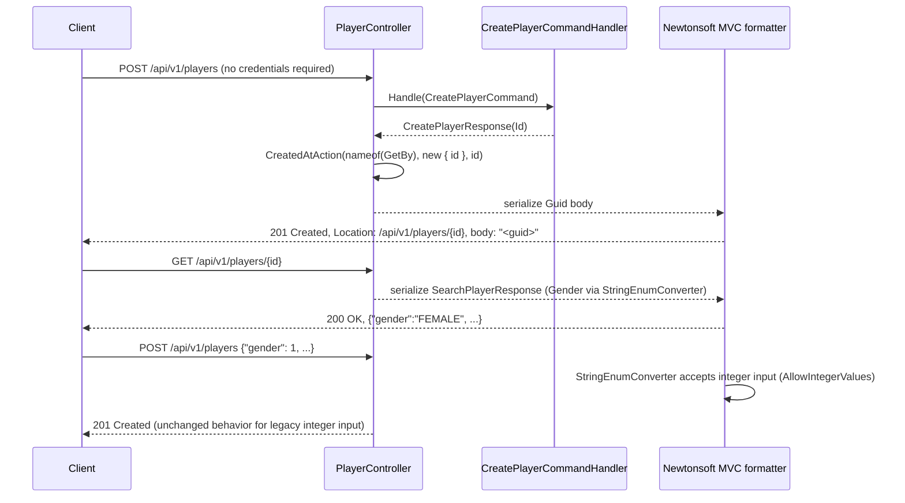

# API Contract and Access — Technical

## Overview

`Startup.ConfigureServices` configures MVC with `AddMvcCore().AddNewtonsoftJson(...)` only: no `AddJsonOptions`/System.Text.Json formatter is registered. The Newtonsoft settings add `StringEnumConverter` (default settings: `AllowIntegerValues = true`), so `Gender` and `FacilityType` serialize as their name and still deserialize from either name or integer. `PlayerController.Create` and `FacilitiesController.Create` return `Task<ActionResult<Guid>>` via `CreatedAtAction(nameof(GetBy), new { id }, id)`, which produces `201 Created`, a `Location` header built from the `GetBy` route (`/api/v{version}/{resource}/{id}`), and the `Guid` as the JSON body. `Startup.ConfigureServices` no longer calls `AddAuthorization`, and `Configure` no longer calls `UseAuthentication`/`UseAuthorization`; `Gaffer.Api/Startups/AuthenticationStartup.cs` (cookie scheme registration) was deleted. No controller or action carries `[Authorize]`.

## Sequence Diagram



## Methods & Properties Table

| Class | Member | Signature | Return | Description |
|---|---|---|---|---|
| `Startup` | `ConfigureServices` | `void ConfigureServices(IServiceCollection)` | `void` | Registers `AddMvcCore().AddNewtonsoftJson(options => { DateTimeZoneHandling = Utc; Converters.Add(new StringEnumConverter()); })`. No `AddJsonOptions`, no `AddAuthorization`. |
| `Startup` | `Configure` | `void Configure(IApplicationBuilder, IWebHostEnvironment, IApiVersionDescriptionProvider)` | `void` | Pipeline: exception middleware, OpenAPI/Swagger UI, routing, endpoints. No `UseAuthentication`/`UseAuthorization`. |
| `PlayerController` | `Create` | `Task<ActionResult<Guid>> Create([FromBody] CreatePlayerRequest)` | `ActionResult<Guid>` (`201`) | `[ProducesResponseType(typeof(Guid), StatusCodes.Status201Created)]`; `Location` = `GetBy` route with the created id. |
| `FacilitiesController` | `Create` | `Task<ActionResult<Guid>> Create([FromBody] CreateFacilityRequest)` | `ActionResult<Guid>` (`201`) | Same pattern as `PlayerController.Create`. |
| `Gender` / `FacilityType` | enum | — | — | Serialized as name (`MALE`/`FEMALE`/`OTHER`, `Stadium`/`Arena`/`Pitch`/`Training`) via `StringEnumConverter`; integer input on write is still accepted. |
| `Gaffer.Api/nswag.json` | `defaultEnumHandling` | `"String"` | — | OpenAPI document declares enums as `string` with `x-enumNames`, matching the runtime contract; drives `Gaffer.Api.Client` generation. |

## Dependencies

- `Microsoft.AspNetCore.Mvc.NewtonsoftJson` (10.0.10) — the only JSON formatter registered for MVC input/output.
- `Newtonsoft.Json.Converters.StringEnumConverter` — enum text serialization with integer-input fallback.
- `Gaffer.Api/nswag.json` (`defaultEnumHandling: "String"`) — keeps the generated OpenAPI document and `Gaffer.Api.Client` aligned with the runtime enum format; see [`api-client-versioning.md`](./api-client-versioning.md) for the versioning rule that applies when this contract changes again.
- `ExceptionHandlingMiddleware` — unaffected; error bodies still use `JsonConvert.SerializeObject` directly (PascalCase), out of scope for this change.
- Removed: `Gaffer.Api/Startups/AuthenticationStartup.cs` (cookie scheme), `Microsoft.AspNetCore.Authentication.JwtBearer` package reference (was unused).

## Usage Examples

### Create returns 201 + Location

```http
POST /api/v1/players HTTP/1.1
Content-Type: application/json

{ "firstName": "Alexia", "lastName": "Putellas", "birthDate": "1994-02-04T00:00:00Z", "gender": "FEMALE" }
```

```http
HTTP/1.1 201 Created
Location: /api/v1/players/75d5...
Content-Type: application/json

"75d5..."
```

### Enum serialized as text, integer input still accepted

```json
GET /api/v1/players/75d5...
{"id":"75d5...","firstName":"Alexia","lastName":"Putellas","secondLastName":"Segura","birthDate":"1994-02-04T00:00:00Z","gender":"FEMALE"}
```

```json
POST /api/v1/facilities { "type": 1, ... }
```
still creates a facility with `Type = FacilityType.Arena` (accepted via `StringEnumConverter`'s `AllowIntegerValues`).

### No authentication required

```http
GET /api/v1/facilities HTTP/1.1
```

Returns `200 OK` without any `Authorization` header or cookie; there is no login endpoint and no `[Authorize]` attribute anywhere in the API.

## How to test

- `Gaffer.Api.Tests/Acceptance/PlayerFeaturesShould.cs`, `Gaffer.Api.Tests/Acceptance/FacilityFeaturesShould.cs`: `201`/`Location` assertions on create, enum-as-text and integer-input acceptance.
- `Gaffer.Api.Tests/Unit/Controllers/PlayerControllerShould.cs`: unit assertion on `CreatedAtActionResult`.
- `Gaffer.Api.Tests` `AnonymousAccessShould` / `StartupSecurityShould` (in `TestFixture`/`Startup` tests): assert no authentication scheme is registered and endpoints respond without credentials.
- `OpenApiContractShould`: reads `/swagger/v1/swagger.json` from a real `Startup` and asserts enum properties are `type: string` with `x-enumNames`.
- Run with `dotnet test gaffer-api.sln` (requires a configured MySQL connection string; see [`database-configuration.md`](./database-configuration.md)).
