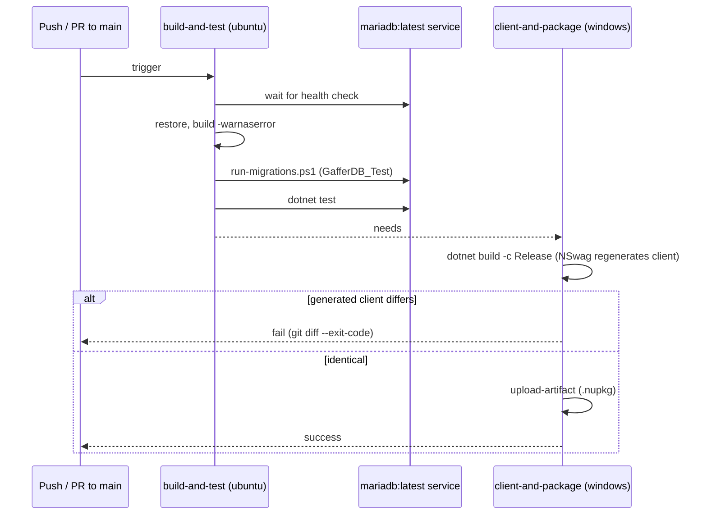

# CI with GitHub Actions — Technical

## Overview

`.github/workflows/ci.yml` runs on `push` and `pull_request` to `main` with `permissions: contents: read`. Two jobs split by operating system, because the NSwag client generation in `Gaffer.Api.csproj` runs only on Windows in a non-Debug build, while the database service container needs Linux:

1. `build-and-test` (ubuntu-latest): service `mariadb:latest` with a health check, ephemeral container credentials, `dotnet restore`, `dotnet build gaffer-api.sln --no-restore -warnaserror`, `dotnet format gaffer-api.sln --verify-no-changes --severity info --exclude Gaffer.Api.Client/` (TECHDEBT-006), `pwsh ./scripts/run-migrations.ps1` against `GafferDB_Test`, `dotnet test gaffer-api.sln --no-build`.
2. `client-and-package` (windows-latest, `needs: build-and-test`): `dotnet build gaffer-api.sln -c Release` regenerates `Gaffer.Api.Client`; `git diff --exit-code` over `GafferApiClient.cs` and `OpenApiSpecs.json` fails the job if the generated client differs from the versioned one; `actions/upload-artifact` stores the `.nupkg`. Nothing is published.

The generated client is never edited by agents. When the contract changes, the operator regenerates and versions it (MINOR bump of `GlobalPackageVersion`, MAJOR for an incompatible change) before the run.

## Sequence Diagram

## Methods & Properties Table

| Element | Value | Description |
|---|---|---|
| Triggers | `push`, `pull_request` on `main` | |
| Job `build-and-test` | ubuntu-latest, `mariadb:latest` | Warnings are errors; migrations and tests use `ConnectionStrings__GafferDB_Test` and `ConnectionStrings__Database`. |
| Job `client-and-package` | windows-latest, `needs` | Release build with `DatabaseConfig__Enabled=false` so the NSwag target needs no database. |
| Format gate | `dotnet format gaffer-api.sln --verify-no-changes --severity info --exclude Gaffer.Api.Client/` | Step in `build-and-test`, after the `-warnaserror` build and before migrations and tests. Fails (exit 2) when any `.cs` file in `Gaffer.Api`, `Gaffer.Api.Tests` or `Gaffer.Api.Migrations` differs from what the root `.editorconfig` produces. No package added: `dotnet format` is part of the .NET SDK. |
| Client gate | `git diff --exit-code -- Gaffer.Api.Client/GafferApiClient.cs Gaffer.Api.Client/OpenApiSpecs.json` | Fails when the contract changed and the client was not regenerated. |
| Artifact | `.nupkg` from `Gaffer.Api.Client/bin/Release` | Uploaded, not published. |

## Dependencies

- Root `.editorconfig` and `dotnet format` (part of the .NET SDK, no package): see "Code style (.editorconfig)" below.

- `scripts/run-migrations.ps1`, `Gaffer.Api.Migrations`: [`database-configuration.md`](./database-configuration.md).
- Client versioning and package: [`api-client-versioning.md`](./api-client-versioning.md).
- `global.json` for the SDK; `Directory.Build.props` for `TreatWarningsAsErrors` and the client version.

## Usage Examples

Evidence in TECHDEBT-004 (public repository, PR #1):

| Run | Commit | Result |
|---|---|---|
| [38156628192](https://github.com/Aaronhdez/GafferApi/actions/runs/38156628192) | `e56d6d2` | `build-and-test` success; `client-and-package` failed on the client diff (`OpenApiSpecs.json` lacked `nullable` / `oneOf` for `birthDate` and `gender`) |
| [38157387185](https://github.com/Aaronhdez/GafferApi/actions/runs/38157387185) | `9ebf767` | both jobs success, artifact uploaded |

Typical cause of a red client job: change a controller or DTO, then regenerate (Release build on Windows), commit the new client and bump the version.

## Code style (.editorconfig)

The root `.editorconfig` holds the code style the operator decided per block (Q15, Q16, Q18, Q19 of plan `TECHDEBT-006`):

| Area | Rule |
|---|---|
| Files | `charset = utf-8` (no BOM), `end_of_line = lf`, final newline, trim trailing whitespace, spaces; indent 4 for `.cs`, 2 for `.json`/`.yml`/`.yaml`/`.md`; no line-length limit |
| Braces and namespaces | K&R (open brace on the same line; `else`/`catch`/`finally` on the line of the closing brace); file-scoped namespaces |
| Style | `var` always; braces optional for a single line (`when_multiline`); `using` outside the namespace, `System` first, no blank line between groups; primary constructors; expression-bodied members when they fit on one line; collection-expression and pattern-matching preferences are not enforced |
| Names | PascalCase for types, members, `const` and `static readonly` fields; camelCase without underscore for private fields (`client`, not `_client`), parameters and locals; interfaces start with `I`; no rule for the `Async` suffix |
| Severity | "suggestion + CI format": rules are `suggestion` and the CI step enforces them (no `EnforceCodeStyleInBuild`). `category-Style` is `none` with an allow-list of the decided IDE rules; 11 info-level analyzer rules the operator did not decide are set to `none` one by one (`CA1068`, `CA1816`, `CA1822`, `CA1846`, `CA1859`, `CA1861`, `CA1873`, `CA2016`, `CA2211`, `CA2263`, `NUnit1028`). Q19 had no operator answer, so its default options applied |
| Scope | `Gaffer.Api`, `Gaffer.Api.Tests`, `Gaffer.Api.Migrations`; `[Gaffer.Api.Client/**.cs]` has `generated_code = true` and the client is excluded from `dotnet format` |

The one-off reformat touched 107 `.cs` files (K&R, line endings, BOM removal, `using` order, file-scoped namespaces, expression-bodied members, `_field` to `field`). The three migrations changed only in format: the `[Migration(...)]` attributes and SQL literals are unchanged (`DatabaseSchemaShould` and `run-migrations.ps1` pass). The served `swagger.json` is identical (same sha256) before and after. Some renames beyond private fields were needed for the naming rules to pass: the internal properties `criteriaList` became `CriteriaList` (`FacilitySearchCriteria`, `PlayerSearchCriteria`), and the test members `_tablesToDelete`/`_databaseConnectionProvider` became `TablesToDelete`/`DatabaseConnectionProvider`.

Apply locally: `dotnet format gaffer-api.sln --severity info --exclude Gaffer.Api.Client/` (it can need two passes). Verify: the CI command above.

## How to test

- `actionlint` (Docker image `rhysd/actionlint`) over `.github/workflows/ci.yml`: exit 0.
- Locally: `dotnet build gaffer-api.sln -warnaserror`, `./scripts/run-migrations.ps1`, `dotnet test gaffer-api.sln`.
- The workflow itself can only be exercised by a real GitHub run.
- The format step has not run on GitHub yet: `AC3.11` was demonstrated from the `ci.yml` diff (one added line, after `-warnaserror`, before migrations and tests), and the real run is an operator action after the push. Locally it exits 0 on the working tree and exits 2 on `HEAD` with only the new `.editorconfig` (1270 whitespace, 87 naming, 43 final-newline, 42 expression-body, 40 charset findings and others).
- A working copy checked out before `.gitattributes` fixed `*.cs` to LF may have CRLF files and show `ENDOFLINE` findings locally; a fresh checkout (the CI) does not. The step also depends on the SDK from `global.json` being the same locally and in CI, because analyzers can change with the SDK patch.
- Known limits: `mariadb:latest` moves between versions, so a run can change without a repository change. The `.gitattributes` rule covers only `*.cs`; a `*.json text eol=lf` rule is an approved, optional improvement (OPT-028), not the cause of the failed run above.
