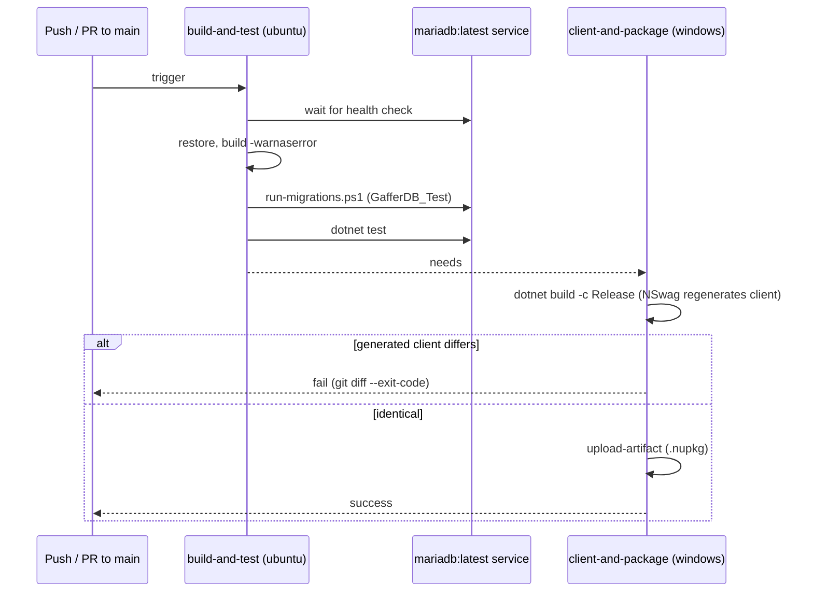

# CI with GitHub Actions — Technical

## Overview

`.github/workflows/ci.yml` runs on `push` and `pull_request` to `main` with `permissions: contents: read`. Two jobs split by operating system, because the NSwag client generation in `Gaffer.Api.csproj` runs only on Windows in a non-Debug build, while the database service container needs Linux:

1. `build-and-test` (ubuntu-latest): service `mariadb:latest` with a health check, ephemeral container credentials, `dotnet restore`, `dotnet build gaffer-api.sln --no-restore -warnaserror`, `pwsh ./scripts/run-migrations.ps1` against `GafferDB_Test`, `dotnet test gaffer-api.sln --no-build`.
2. `client-and-package` (windows-latest, `needs: build-and-test`): `dotnet build gaffer-api.sln -c Release` regenerates `Gaffer.Api.Client`; `git diff --exit-code` over `GafferApiClient.cs` and `OpenApiSpecs.json` fails the job if the generated client differs from the versioned one; `actions/upload-artifact` stores the `.nupkg`. Nothing is published.

The generated client is never edited by agents. When the contract changes, the operator regenerates and versions it (MINOR bump of `GlobalPackageVersion`) before the run.

## Sequence Diagram

## Methods & Properties Table

| Element | Value | Description |
|---|---|---|
| Triggers | `push`, `pull_request` on `main` | |
| Job `build-and-test` | ubuntu-latest, `mariadb:latest` | Warnings are errors; migrations and tests use `ConnectionStrings__GafferDB_Test` and `ConnectionStrings__Database`. |
| Job `client-and-package` | windows-latest, `needs` | Release build with `DatabaseConfig__Enabled=false` so the NSwag target needs no database. |
| Client gate | `git diff --exit-code -- Gaffer.Api.Client/GafferApiClient.cs Gaffer.Api.Client/OpenApiSpecs.json` | Fails when the contract changed and the client was not regenerated. |
| Artifact | `.nupkg` from `Gaffer.Api.Client/bin/Release` | Uploaded, not published. |

## Dependencies

- `scripts/run-migrations.ps1`, `Gaffer.Api.Migrations`: [`database-configuration.md`](./database-configuration.md).
- Client versioning and package: [`api-client-versioning.md`](./api-client-versioning.md).
- `global.json` for the SDK; `Directory.Build.props` for `TreatWarningsAsErrors` and the client version.

## Usage Examples

Evidence in TECHDEBT-004 (public repository, PR #1):

| Run | Commit | Result |
|---|---|---|
| [38156628192](https://github.com/Aaronhdez/GafferApi/actions/runs/38156628192) | `e56d6d2` | `build-and-test` success; `client-and-package` failed on the client diff (`OpenApiSpecs.json` lacked `nullable` / `oneOf` for `birthDate` and `gender`) |
| [38157387185](https://github.com/Aaronhdez/GafferApi/actions/runs/38157387185) | `9ebf767` | both jobs success, artifact uploaded |

Typical cause of a red client job: change a controller or DTO, then regenerate (Release build on Windows), commit the new client and bump the version.

## How to test

- `actionlint` (Docker image `rhysd/actionlint`) over `.github/workflows/ci.yml`: exit 0.
- Locally: `dotnet build gaffer-api.sln -warnaserror`, `./scripts/run-migrations.ps1`, `dotnet test gaffer-api.sln`.
- The workflow itself can only be exercised by a real GitHub run.
- Known limits: `mariadb:latest` moves between versions, so a run can change without a repository change. The `.gitattributes` rule covers only `*.cs`; a `*.json text eol=lf` rule is an approved, optional improvement (OPT-028), not the cause of the failed run above.
