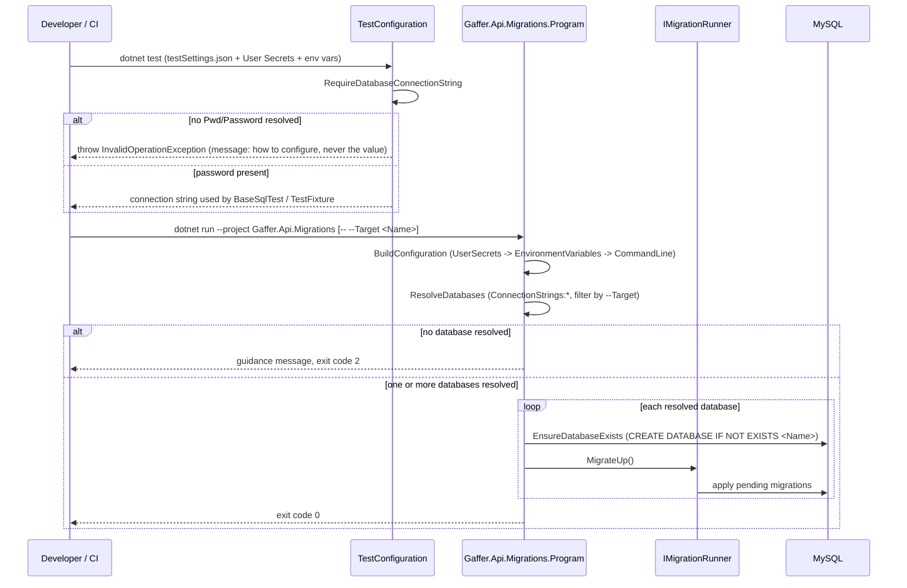

# Database Configuration and Credentials — Technical

## Overview

Three projects each build their own `IConfigurationRoot` with an explicit provider order, so "last provider wins" defines precedence. `Gaffer.Api.Tests/TestConfiguration.cs` is the single source for the test connection string: `testSettings.json` → `AddUserSecrets` → `AddEnvironmentVariables`. `Gaffer.Api.Migrations/Program.cs` builds its configuration from `AddUserSecrets<Program>` → `AddEnvironmentVariables` → `AddCommandLine(args)`, then resolves every non-blank `ConnectionStrings:<Name>` entry (optionally narrowed by `--Target <Name>`) and migrates each one in turn; if none resolve, it writes a guidance message to `stderr`/`stdout` and returns exit code `2` without running FluentMigrator. `Gaffer.Api` itself reads `DatabaseConfig:ConnectionString` through the standard ASP.NET Core host configuration (`appsettings.json` → `appsettings.{Environment}.json` → User Secrets in Development → environment variables), unchanged in mechanism; only the *value* moved out of the versioned file.

## Sequence Diagram



## Methods & Properties Table

| Class | Member | Signature | Return | Description |
|---|---|---|---|---|
| `TestConfiguration` | `AddSources` | `IConfigurationBuilder AddSources(IConfigurationBuilder)` | `IConfigurationBuilder` | `testSettings.json` (required) → `AddUserSecrets(typeof(TestConfiguration).Assembly)` (optional) → `AddEnvironmentVariables()`. Last source wins. |
| `TestConfiguration` | `RequireDatabaseConnectionString` | `string RequireDatabaseConnectionString(IConfiguration)` | `string` | Reads `ConnectionStrings:Database`; throws `InvalidOperationException` with the `dotnet user-secrets set ...` command and the `ConnectionStrings__Database` env var name if `Pwd`/`Password` is absent or empty. Never includes the configured value in the message. |
| `TestConfiguration` | `HasPassword` (private) | `bool HasPassword(string?)` | `bool` | Parses the connection string with `DbConnectionStringBuilder` and checks for a non-empty `Pwd` or `Password` key. |
| `TestConfiguration` | `ToUnreachable` | `string ToUnreachable(string)` | `string` | Same connection string with `Port=1` and a 2s timeout, for tests that need a deliberately unreachable database. |
| `Gaffer.Api.Migrations.Program` | `BuildConfiguration` (private) | `IConfigurationRoot BuildConfiguration(string[])` | `IConfigurationRoot` | `AddUserSecrets<Program>` → `AddEnvironmentVariables` → `AddCommandLine(args)`. |
| `Gaffer.Api.Migrations.Program` | `ResolveDatabases` (private) | `List<DatabaseSettings> ResolveDatabases(IConfiguration)` | `List<DatabaseSettings>` | Collects every non-blank `ConnectionStrings:<Name>`; if `--Target <Name>` (case-insensitive) is set, filters to that one. Throws `InvalidOperationException` (caught in `Main`, exit code `2`) if the result is empty. |
| `Gaffer.Api.Migrations.Program` | `Main` | `int Main(string[])` | `int` | Runs `ApplyMigrationsIn` for every resolved database; returns `2` on configuration failure, `0` on success (a per-database migration exception still calls `Environment.Exit(1)` inside `ApplyMigrationsIn`). |
| `Gaffer.Api.Migrations.Program` | `EnsureDatabaseExists` (private) | `void EnsureDatabaseExists(string, string)` | `void` | `CREATE DATABASE IF NOT EXISTS <databaseName>` using the configuration key name, before running migrations. |

## Dependencies

- `Microsoft.Extensions.Configuration.UserSecrets` (10.0.10, in `Gaffer.Api.Migrations`), `Microsoft.Extensions.Configuration.EnvironmentVariables` (10.0.10), `Microsoft.Extensions.Configuration.CommandLine` (10.0.10).
- `Gaffer.Api.Tests.csproj` `UserSecretsId` `gaffer-api-tests-9423e01b-aca7-40a3-9649-8746b49b2c6e`; `Gaffer.Api.csproj` `UserSecretsId` `gaffer-api-3c01a179-00b4-4838-9f7c-d95ec4b117fb`; `Gaffer.Api.Migrations.csproj` `UserSecretsId` `gaffer-api-migrations-e73209ac-b174-4df6-958e-bd246bbe0cf9`.
- `BaseSqlTest`, `TestFixture` and all MySQL-backed tests consume `TestConfiguration.DatabaseConnectionString`/`UnreachableDatabaseConnectionString` — no test builds its own connection string anymore.
- Runtime connection handling once a string is resolved: [`database-connection-lifecycle.md`](./database-connection-lifecycle.md).

## Usage Examples

### Configure a local machine (values below are placeholders, not real credentials)

```bash
dotnet user-secrets set "DatabaseConfig:ConnectionString" "Server=127.0.0.1;Port=3306;Database=GafferDB;Uid=<user>;Pwd=<password>;" --project Gaffer.Api
dotnet user-secrets set "ConnectionStrings:Database" "Server=127.0.0.1;Port=3306;Database=GafferDB_Test;Uid=<user>;Pwd=<password>;" --project Gaffer.Api.Tests
dotnet user-secrets set "ConnectionStrings:GafferDB" "Server=127.0.0.1;Port=3306;Database=GafferDB;Uid=<user>;Pwd=<password>;" --project Gaffer.Api.Migrations
dotnet user-secrets set "ConnectionStrings:GafferDB_Test" "Server=127.0.0.1;Port=3306;Database=GafferDB_Test;Uid=<user>;Pwd=<password>;" --project Gaffer.Api.Migrations
```

### Equivalent environment variables (CI, take precedence over User Secrets/files)

```bash
DatabaseConfig__ConnectionString=...
ConnectionStrings__Database=...
ConnectionStrings__GafferDB=...
ConnectionStrings__GafferDB_Test=...
```

### Run migrations against a single database

```bash
ConnectionStrings__GafferDB_Test="Server=127.0.0.1;Port=3306;Database=GafferDB_Test;Uid=<user>;Pwd=<password>;" \
  dotnet run --project Gaffer.Api.Migrations -- --Target GafferDB_Test
```

Without any connection string configured, the same command exits with code `2` and prints the key(s) to configure.

## How to test

- `Gaffer.Api.Tests/Unit/*` (`TestConfigurationShould`, `ApiDatabaseConfiguration*`): precedence order, missing-password failure message, `ToUnreachable` port override.
- `Gaffer.Api.Tests/Integration/DatabaseStartupShould.cs`: startup fallback behavior when the configured database is unreachable, and that no `Pwd=`/credentials ever appear in logs.
- Manual: `dotnet run --project Gaffer.Api.Migrations --no-build` with no configuration (expect exit `2`), then with `--Target <Name>` and a configured secret/env var (expect exit `0`).
- `dotnet test gaffer-api.sln` without any secret/env var configured fails every MySQL-backed test with the guidance message (expected, not a regression); configuring the secret/env var makes the suite pass.
