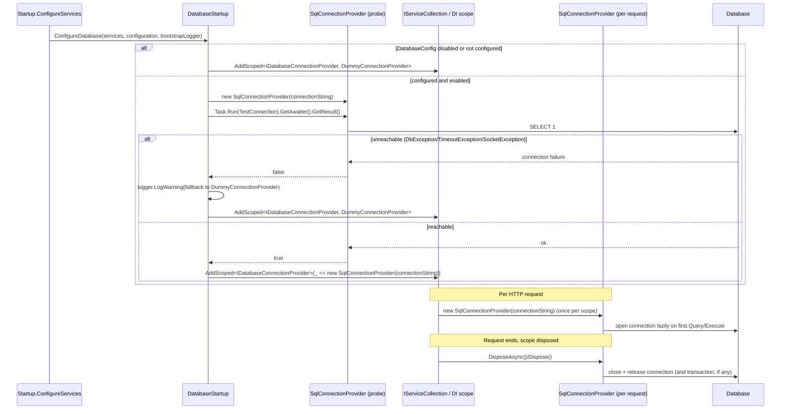

# Database Connection Lifecycle

## Overview

`DatabaseStartup.ConfigureDatabase` registers `IDatabaseConnectionProvider` as `AddScoped`, so ASP.NET Core creates one `SqlConnectionProvider` instance per DI scope (per HTTP request) and disposes it when the scope ends. `SqlConnectionProvider` implements `IDisposable`/`IAsyncDisposable` so the underlying `MySqlConnection` and any open transaction are closed and released at that point. At startup, `DatabaseStartup` probes connectivity with a throwaway `SqlConnectionProvider` (`TestConnection`, a schema-independent `SELECT 1;`); if the probe fails, it registers `DummyConnectionProvider` instead and logs a single warning through a short-lived bootstrap `ILoggerFactory` created in `Startup.ConfigureServices` (the host's own logging pipeline is not yet resolvable at that point).

## Sequence Diagram



## Methods & Properties Table

| Class | Member | Signature | Return | Description |
|---|---|---|---|---|
| `DatabaseStartup` | `ConfigureDatabase` | `void ConfigureDatabase(this IServiceCollection, IConfiguration, ILogger? logger = null)` | `void` | Reads `DatabaseConfig` (`Enabled`, `ConnectionString`). Registers the dummy provider if disabled/not configured; otherwise probes connectivity and registers either `SqlConnectionProvider` (reachable) or the dummy provider with a warning log (unreachable). |
| `DatabaseStartup` | `ConnectionIsUp` (private) | `bool ConnectionIsUp(string connectionString)` | `bool` | Creates a throwaway `SqlConnectionProvider` in a `using` block and runs `TestConnection()` via `Task.Run(...).GetAwaiter().GetResult()` (avoids a synchronization-context deadlock and unwraps `AggregateException`). |
| `DatabaseStartup` | `AddDummyConnector` (private) | `void AddDummyConnector(IServiceCollection)` | `void` | `services.AddScoped<IDatabaseConnectionProvider, DummyConnectionProvider>()`. |
| `SqlConnectionProvider` | `TestConnection` | `Task<bool> TestConnection()` | `bool` | Opens the connection if needed, runs `SELECT 1;`, and returns `true`/`false`. Catches `DbException`, `TimeoutException`, and `SocketException` (returns `false`) instead of throwing; always closes the connection it opened itself. |
| `SqlConnectionProvider` | `IsDisposed` | `bool` (get) | `bool` | `true` once `Dispose()`/`DisposeAsync()` has run; both methods are idempotent (a second call is a no-op). |
| `SqlConnectionProvider` | `ConnectionState` | `ConnectionState` (get) | `ConnectionState` | Exposes the underlying `MySqlConnection.State` (e.g. `Open`/`Closed`) for diagnostics/tests. |
| `SqlConnectionProvider` | `DisposeAsync` | `ValueTask DisposeAsync()` | `ValueTask` | Disposes any pending transaction, then closes and disposes the connection. Invoked automatically by the DI container when an async-disposable scope ends. |
| `SqlConnectionProvider` | `Dispose` | `void Dispose()` | `void` | Synchronous counterpart of `DisposeAsync`, used when the scope is disposed synchronously. |
| `SqlConnectionProvider` | `ExecuteInTransactionAsync` | `Task ExecuteInTransactionAsync(Func<Task> operations)` | `Task` | Begins a transaction on the instance's own connection (reused for nested calls on the same instance), commits on success, rolls back and rethrows on failure; the transaction and connection are scoped to the request because the provider itself is scoped to the request. |
| `DatabaseConfig` | properties | `bool Enabled`, `string? ConnectionString` | — | Bound from the `DatabaseConfig` configuration section. |

## Dependencies

- `Startup.ConfigureServices`: creates a short-lived bootstrap `LoggerFactory` (`Console` + the `Logging` configuration section), passes its logger into `ConfigureDatabase`, and disposes the factory immediately after — the host's own logging pipeline is not resolvable while services are still being registered.
- `IDatabaseConnectionProvider` consumers: `SqlPlayerRepository`, `SqlFacilityRepository` (any repository using `QueryAsync`/`ExecuteAsync`/`ExecuteInTransactionAsync` is bound to the same per-request instance and lifecycle described here — see [`player-search-and-persistence.md`](./player-search-and-persistence.md)).
- A mid-request failure to reach the database (as opposed to the startup fallback described above) during Delete/Update on Players or Facilities surfaces as an unmapped `500` through `ExceptionHandlingMiddleware`, logged once at `Error`: [`error-handling.md`](./error-handling.md).
- `Gaffer.Api.Tests/TestFixture.cs`: registers `IDatabaseConnectionProvider` per scope with a factory that creates `new SqlConnectionProvider(testDatabase)`, mirroring the production `AddScoped` registration for test isolation between requests hitting the in-memory `TestServer`.
- `DummyConnectionProvider`: the no-op fallback; `TestConnection()` always returns `true`, and mutating operations throw `NotImplementedException` (used only when the database is disabled/unreachable).
- `DatabaseConfig:ConnectionString` is now expected to come from User Secrets or an environment variable rather than a committed password; see [`database-configuration.md`](./database-configuration.md) for the exact keys and precedence.

## Usage Examples

### Startup registration (production)

```csharp
using (var startupLoggerFactory = LoggerFactory.Create(builder => builder
           .AddConfiguration(configuration.GetSection("Logging"))
           .AddConsole()))
{
    services.ConfigureDatabase(configuration, startupLoggerFactory.CreateLogger(typeof(DatabaseStartup)));
}
```

### Consuming the per-request provider

```csharp
public class SqlPlayerRepository(IDatabaseConnectionProvider dbConnectionProvider) : IPlayerRepository
{
    public async Task<List<Player>> Get(PlayerSearchCriteria criteria, CancellationToken cancellationToken)
    {
        var (whereClause, parameters) = BuildFilters(criteria);
        return await dbConnectionProvider.QueryAsync<Player>($"SELECT * FROM `Players`{whereClause};", parameters);
    }
}
```

Two concurrent requests resolve two different `IDatabaseConnectionProvider` instances (from two different DI scopes); each instance is closed and disposed automatically when its request's scope ends.

### Observed log entry on startup fallback

```
warn: Gaffer.Api.Startups.DatabaseStartup[0]
      Database is not reachable at startup; falling back to DummyConnectionProvider.
```

No connection string or credentials appear in this message.
