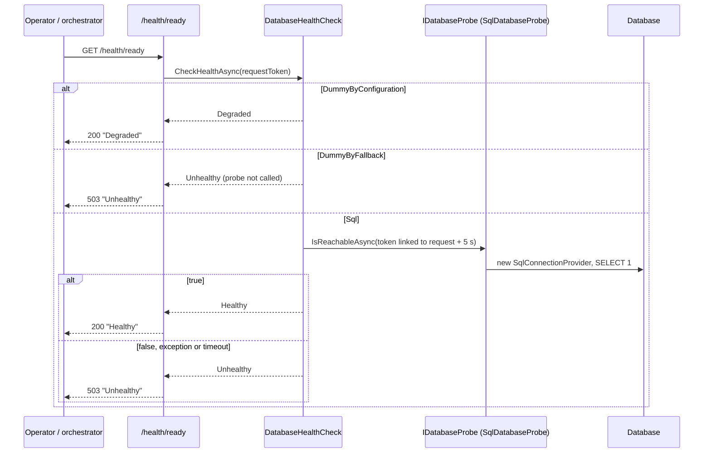

# Health Checks — Technical

## Overview

`DatabaseStartup.ConfigureDatabase` records why it chose the connection provider as a singleton `DatabaseProviderSelection(DatabaseProviderReason)` (`Sql`, `DummyByConfiguration`, `DummyByFallback`) and registers a health check named `database` tagged `ready` through `AddHealthChecks()` (ASP.NET Core shared framework, no new package). The provider chosen is unchanged. `DatabaseHealthCheck` decides from the reason, not from `IDatabaseConnectionProvider.TestConnection()`, because `DummyConnectionProvider.TestConnection()` always returns `true`. `Startup.Configure` maps `/health/live` (`Predicate = _ => false`, no check evaluated) and `/health/ready` (only checks tagged `ready`) with the framework's default writer and status codes.

## Sequence Diagram



## Methods & Properties Table

| Class | Member | Signature | Description |
|---|---|---|---|
| `DatabaseProviderReason` | enum | `Sql`, `DummyByConfiguration`, `DummyByFallback` | Why the provider was chosen. |
| `DatabaseProviderSelection` | record | `DatabaseProviderSelection(DatabaseProviderReason Reason)` | Singleton registered in every branch of `ConfigureDatabase`. |
| `DatabaseStartup` | `ConfigureDatabase` | `void ConfigureDatabase(this IServiceCollection, IConfiguration, ILogger? = null)` | Disabled or no connection string → dummy (`DummyByConfiguration`); startup probe fails → dummy plus the warning log (`DummyByFallback`); else `SqlConnectionProvider` plus `IDatabaseProbe` = `SqlDatabaseProbe(connectionString)`. |
| `DatabaseStartup` | `ReadyTag` | `const string = "ready"` | Tag shared with the route predicate. |
| `IDatabaseProbe` / `SqlDatabaseProbe` | `IsReachableAsync` | `Task<bool> IsReachableAsync(CancellationToken)` | Creates a `SqlConnectionProvider` per check and calls the new `TestConnection(CancellationToken)` overload. |
| `SqlConnectionProvider` | `TestConnection` | `Task<bool> TestConnection(CancellationToken)` | Overload with token (`OpenAsync`/`ExecuteScalarAsync`); an already cancelled token throws without touching the connection. `TestConnection()` delegates with `default`; `IDatabaseConnectionProvider` is unchanged. |
| `DatabaseHealthCheck` | `CheckHealthAsync` | `Task<HealthCheckResult> CheckHealthAsync(HealthCheckContext, CancellationToken)` | `DummyByConfiguration` → `Degraded("Database disabled by configuration.")`; `DummyByFallback` → `Unhealthy` without probing; `Sql` → probe with a token linked to the request plus `CancelAfter(timeout)` and `WaitAsync` (bounds the wait even if the probe ignores the token): `true` → `Healthy`, `false`/exception/timeout → `Unhealthy`, each failure also logged at `Warning` (`false`: "the database did not answer", no exception; timeout: "timed out after {Timeout}", no exception; any other exception: logged with the exception); request cancelled → `OperationCanceledException`. Results carry no `Exception` or `Data`; descriptions are fixed texts. |
| `DatabaseHealthCheck` | ctor | `DatabaseHealthCheck(DatabaseProviderSelection, IDatabaseProbe?, TimeSpan? timeout = null, ILogger<DatabaseHealthCheck>? logger = null)` | `timeout` defaults to `DefaultTimeout`; `logger` defaults to `NullLogger`. `DatabaseStartup.AddDatabaseHealthCheck` passes the host `ILogger<DatabaseHealthCheck>`; existing test constructions keep compiling since `logger` is last and optional. |
| `DatabaseHealthCheck` | `DefaultTimeout` | `static readonly TimeSpan` = 5 s | Injectable timeout (TECHDEBT-006): tests use 200 ms instead of waiting 5 s. |

## Dependencies

- `Microsoft.AspNetCore.Diagnostics.HealthChecks` / `Microsoft.Extensions.Diagnostics.HealthChecks` from the shared framework: no `PackageReference` added.
- `DatabaseStartup`, `SqlConnectionProvider`, `DummyConnectionProvider`: [`database-connection-lifecycle.md`](./database-connection-lifecycle.md).
- OpenAPI/client: the routes are not in the served `swagger.json` (identical before and after, sha256 compared with `ServedOpenApiDocumentDump`), so there is no client change.
- Tests: `Gaffer.Api.Tests/TestFixture.cs` registers `DatabaseProviderSelection(Sql)`; its `TestStartup` does not map `/health`, so routes are exercised with `TestShared/StartupTestServer.cs` (overload `StartAsync(bool enabled, string? connectionString)` and `Services`).
- CI is unchanged (it runs with `DatabaseConfig__Enabled: "false"`).

## Usage Examples

```bash
curl -i http://localhost:5000/health/live      # 200 Healthy
curl -i http://localhost:5000/health/ready     # 200 Healthy | 200 Degraded | 503 Unhealthy
```

Fallback case (database enabled but down at startup): `/health/live` answers `200 Healthy` and `/health/ready` answers `503 Unhealthy`, with a body of just the status word.

## How to test

- Acceptance: `Gaffer.Api.Tests/Acceptance/HealthCheckShould.cs` (live and ready healthy, ready `503` on fallback without leaking connection details, ready `200 Degraded` when disabled or without connection string).
- Unit: `Unit/HealthChecks/DatabaseHealthCheckShould.cs` (reason × probe matrix; request cancellation; blocked probe becomes `Unhealthy` after the injected timeout, `DefaultTimeout` is 5 s asserted without waiting; `Warning` logging matrix: throws → with exception, `false`/timeout → without exception, `Healthy`/`Degraded`/fallback → nothing, no sensitive fragment in the message; class time 5.3 s → 0.7 s).
- Integration: `Integration/DatabaseStartupShould.cs` (reason registered per branch and `GiveTheRegisteredHealthCheckTheHostLoggerSoAFailedProbeIsLogged`) and `Unit/ConnectionProviders/SqlConnectionProviderShould.cs` (token overload).
- Run with `dotnet test gaffer-api.sln` against the Docker MariaDB database ([`database-configuration.md`](./database-configuration.md)).
