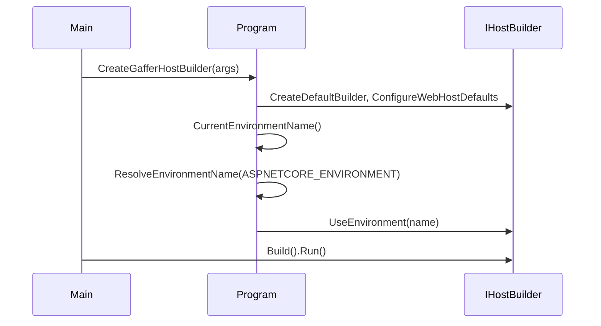

# Hosting Environment — Technical

## Overview

`Program` resolves the hosting environment name from the `ASPNETCORE_ENVIRONMENT` variable. An absent, empty or whitespace-only value falls back to `Development`. The same value feeds the host (`IHostEnvironment`) and `ProductContext.Environment`, which used to be fixed to `Development`. `CreateGafferHostBuilder(args)` builds the host exactly as `Main` runs it; it is deliberately not named `CreateHostBuilder`, so tooling such as NSwag keeps resolving the host through `Main`. `UseEnvironment` is called after `ConfigureWebHostDefaults`: the web defaults copy the raw `ASPNETCORE_*` variables into the host configuration and would otherwise override it.

## Sequence Diagram



## Methods & Properties Table

| Class | Member | Signature | Description |
|---|---|---|---|
| `Program` | `ResolveEnvironmentName` | `static string ResolveEnvironmentName(string? value)` | Value as given, or `Development` when null, empty or blank. |
| `Program` | `CreateGafferHostBuilder` | `static IHostBuilder CreateGafferHostBuilder(string[] args)` | The host `Main` runs; usable from tests. |
| `Program` | `CreateProductContext` | `static ProductContext CreateProductContext()` | Builds the product context for the current process environment. |

## Dependencies

- Environment variable `ASPNETCORE_ENVIRONMENT`.
- Per-environment settings loaded by the host: [`database-configuration.md`](./database-configuration.md).

## Usage Examples

```powershell
$env:ASPNETCORE_ENVIRONMENT = "Staging"; dotnet run --project Gaffer.Api
```

With the variable unset, the API runs as `Development`.

## How to test

- `Gaffer.Api.Tests/Unit/Startups/EnvironmentNameResolutionShould.cs`: present value kept; absent or blank defaults to `Development`.
- `Gaffer.Api.Tests/Integration/HostingEnvironmentShould.cs`: `TakeTheHostEnvironmentFromTheEnvironmentVariable` (`Staging`, `Production`, `null`, `""`, `"   "`) and `RestoreTheEnvironmentVariableAfterEachTest`.
