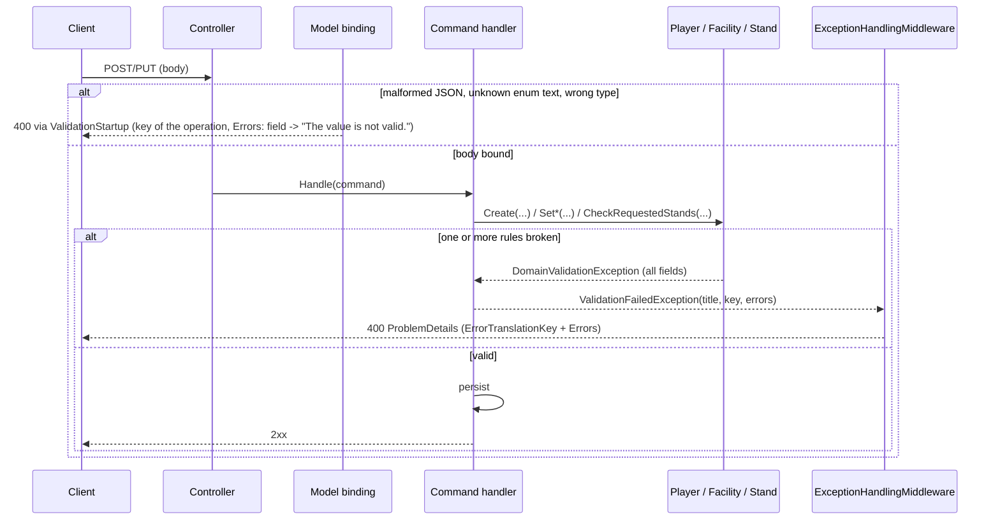

# Input Validation — Technical

## Overview

Validation lives in the domain (no DataAnnotations were added to the DTOs). `Player.Create`, `Facility.Create`, `Address.Create`, `Stand.Create` and the validating `Player.Set*` methods collect every rule violation in a `DomainValidationErrors` and throw one `DomainValidationException` (field → messages). The command handlers catch it and rethrow `ValidationFailedException(title, key, errors)`, which `ExceptionToHttpResponseConverters.BuildValidationProblemDetails` turns into the `400` `ProblemDetails` (`errorTranslationKey`, `errors`) through `ExceptionHandlingMiddleware`. Errors raised by model binding never reach the domain: `ValidationStartup.ConfigureValidationResponses` wraps `ApiBehaviorOptions.InvalidModelStateResponseFactory` so that the six operations in its `Operations` map answer the same format with generic messages; every other action keeps the default factory.

Wire format (TECHDEBT-006): `ExceptionToHttpResponseConverters.Serialize` writes the `400` as an RFC 7807 body with `errorTranslationKey` and `errors` at the root (no `extensions`), `errors` keys in camelCase per segment (`stands[1].standName`) and messages unchanged (they keep the PascalCase field name). A `null` element in `stands` is reported as `Stands[i]` with `Stands[i] is required.` (create and update, instead of the former `500`); it also counts toward the 4-stand cap. `CreateFacilityCommand.Stands` and `UpdateFacilityCommand.Stands` are `IReadOnlyList<T?>?`, and the handlers filter the `null`s with `OfType<T>()` before building domain objects.

The primary constructors of `Player`, `Address`, `Stand` and `Facility` are used to rehydrate stored rows (Dapper in `SqlPlayerRepository`, `new` in `SqlFacilityRepository`) and do **not** validate, so old data still reads (Q16). `Facility`'s constructor keeps only its structural guards (address present, at most 4 stands, `FacilityValidationException`).

## Sequence Diagram



## Methods & Properties Table

| Class | Member | Signature | Description |
|---|---|---|---|
| `DomainValidationErrors` | `Add`, `RequireText`, `Collect`, `ThrowIfAny` | `void Add(string field, string message)`, `void RequireText(string field, string? value, int maxLength)`, `void Collect(Action)`, `void ThrowIfAny()` | Accumulates messages per field (a message is kept once). `RequireText` = required, not whitespace, at most `maxLength`; messages never include the value. `Collect` keeps the errors of a validating operation without failing at once. |
| `DomainValidationException` | `Errors` | `IReadOnlyDictionary<string, string[]>` | Thrown by the domain. |
| `ValidationFailedException` | ctor, `Title`, `ErrorTranslationKey`, `Errors` | `(string title, string errorTranslationKey, IReadOnlyDictionary<string,string[]> errors)` | Application-level exception mapped to `400`; `InvalidFieldsDetail` = `One or more fields are not valid.` |
| `ValidationErrorKeys` | constants | `PlayersCreate`, `PlayersUpdate`, `FacilitiesCreate`, `FacilitiesUpdate`, `FacilitiesStands` | The five keys of the table in [`input-validation.md`](../input-validation.md). |
| `Player` | `Create` | `static Player Create(Guid, string?, string?, string?, Gender, DateTime, DateTime? todayUtc = null)` | Checks names (100), optional second last name (if non-null: same rule), birth date (>= 1900-01-01, not future, `AddYears(16) <= today`) and defined `Gender`. |
| `Player` | `SetFirstName`, `SetLastName`, `SetSecondLastName`, `SetBirthDate(DateTime, DateTime?)`, `SetGender(Gender)` | `void Set*(...)` | Each validates its own field before assigning. `SetSecondLastName` rejects `""`/whitespace. |
| `Facility` | `Create` | `static Facility Create(Guid, string?, bool, DateTime, FacilityType, int, Address?, List<Stand>?, DateTime? todayUtc = null)` | Name (100), `BuildDate` (>= 1800-01-01, not future), defined `Type`, `Capacity >= 0`, address present and valid (`Address.*`), at most 4 stands (`Stands`). Does not check the fields of the stands it receives. |
| `Facility` | `CheckRequestedStands` | `static void CheckRequestedStands(DomainValidationErrors, IReadOnlyList<(string? StandName, int StandCapacity)?>)` | Count (> 4 → `Stands`: `Stands cannot exceed 4.`) and each stand named by index (`Stands[i].StandName`). |
| `Address` | `Create`, `CheckFields` | `static Address Create(Guid, string?, ...)` | Street/City/Region/Country 100, StreetNumber/PostalCode 20; fields named `Address.<Field>`. |
| `Stand` | `Create`, `CheckFields` | `static Stand Create(Guid, string?, int)`, `static void CheckFields(DomainValidationErrors, string fieldPrefix, string?, int)` | `StandName` 1-100, `StandCapacity >= 0`. |
| `CreatePlayerCommandHandler` / `UpdatePlayerCommandHandler` | `Handle` | — | Create calls `Player.Create`. Update reads the player (404 first), then applies every sent field through `Collect(Set*)` and throws once; `null` fields are skipped (including `SecondLastName`). |
| `CreateFacilityCommandHandler` / `UpdateFacilityCommandHandler` | `Handle` | — | Collect `CheckRequestedStands` and `Facility.Create`. Update runs inside the repository lock (404 first); the merge keeps stored stands unvalidated. |
| `AddFacilityStandCommandHandler` / `ReplaceFacilityStandCommandHandler` | `Handle` | — | `StandValidation.Create` (key `Error.Facilities.Stands.Validation`) before calling the repository (400 before 404). |
| `ValidationStartup` | `ConfigureValidationResponses` | `IServiceCollection ConfigureValidationResponses(this IServiceCollection)` | `PostConfigure<ApiBehaviorOptions>`: for the mapped controller actions builds the `400` with `Errors[field] = ["The value is not valid."]`, field names PascalCased from the model state key, the body itself as `Body`. Called from `Startup.ConfigureServices`. |

## Dependencies

- `ExceptionToHttpResponseConverters` (`ValidationFailedException` entry, `BuildValidationProblemDetails`, `Serialize`) and `ExceptionHandlingMiddleware`: [`error-handling.md`](./error-handling.md).
- `IPlayerRepository` / `IFacilityRepository` only after validation passes; `IFacilityRepository.Update(id, buildUpdated, ct)` is the only public update of a facility ([`facility-update.md`](./facility-update.md)).
- OpenAPI/client: no attribute, route or DTO was added, so the served `swagger.json` is unchanged (verified with `ServedOpenApiDocumentDump`, same sha256 before and after) and the generated client needs no regeneration for this change.
- No new package.
- Tests need `Gaffer.Api.Tests/TestFixture.cs` DI registrations in line with the handlers.

## Usage Examples

```http
POST /api/v1/facilities HTTP/1.1
Content-Type: application/json

{ "name": "", "active": true, "buildDate": "1998-05-01T00:00:00Z", "type": "Stadium", "capacity": -1,
  "address": { "street": "Av. Siempre Viva", "streetNumber": "123", "postalCode": "1000", "city": "Buenos Aires", "region": "CABA", "country": "Argentina" },
  "stands": [ { "standName": "North", "standCapacity": 100 }, { "standName": " ", "standCapacity": 10 } ] }
```

`400`, `Error.Facilities.Create.Validation`, `errors` with `name`, `capacity` and `stands[1].standName`.

```http
PUT /api/v1/players/75d5... HTTP/1.1
Content-Type: application/json

{ "secondLastName": "" }
```

`400`, `Error.Players.Update.Validation`, `Errors.SecondLastName`. Nothing is saved.

## How to test

- Domain/unit: `Gaffer.Api.Tests/Unit/` `Player`, `Facility`, `Address`, `Stand` rule matrices; `Unit/Commands/{Players,Facilities,Stands}/*Should` for each handler (one case per rule, no `Update` call on error); `Unit/Exceptions/ExceptionToHttpResponseConvertersShould.cs`.
- Acceptance: `Acceptance/PlayerFeaturesShould.cs`, `FacilityFeaturesShould.cs`, `FacilityStandsFeaturesShould.cs` (400 format, keys, model binding, old data still read); the production pipeline cases (`AddMvcCore`, where `TestFixture` differs) use `TestShared/StartupTestServer.cs`.
- Contract: `OpenApiContractShould`, `FacilitiesControllerContractShould`; compare the served document with `Acceptance/ServedOpenApiDocumentDump.cs` ([`.github/doc/common/test-stack.md`](../../../.github/doc/common/test-stack.md)).
- Run with `dotnet test gaffer-api.sln` against the Docker MariaDB database ([`database-configuration.md`](./database-configuration.md)).
