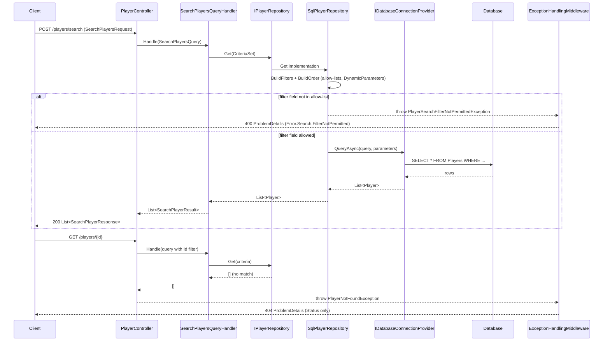

# Player Search and Persistence

## Overview

FEAT-001 replaced the single-purpose `PlayerSearchCriteria` with a `CriteriaSet` (`Gaffer.Api/Shared/Criteria/`): value criteria (`ValueCriteria`: `AND`/`OR`/`LIKE`, several values per criterion), interval criteria (`IntervalCriteria<T>`: `BETWEEN`) and order criteria (`OrderCriteria`: `ORDER BY`). The HTTP contract is unchanged: `SearchPlayersQueryHandler` still maps each request filter to one `ValueCriteria` of type `AND` with one value, so `POST /players/search` behaves exactly as before. Interval, order, `OR` and `LIKE` are reachable only through `IPlayerRepository.Get(CriteriaSet, ...)`, not through any endpoint (demonstrated by the SQL-shape and MySQL-backed repository tests in `REVIEW.md`).

`SqlPlayerRepository.Get` builds a parameterized, allow-listed `WHERE` (and optional `ORDER BY`) clause for `POST /api/v{version}/players/search` and `GET /api/v{version}/players/{id}` (the latter runs the search with a single `Id` filter). A filter field outside the allow-list throws `PlayerSearchFilterNotPermittedException`, mapped to `400 Bad Request`. An unknown player id ends the search with an empty result, and `PlayerController.GetBy` turns that into `PlayerNotFoundException`, mapped to a bare `404 Not Found`.

Related architecture: [`facility-crud.md`](../../../.github/doc/features/facility-crud.md) documents the equivalent allow-list pattern already used by `SqlFacilityRepository`, which this change now mirrors for `SqlPlayerRepository`.

## Sequence Diagram



## Methods & Properties Table

| Class | Member | Signature | Return | Description |
|---|---|---|---|---|
| `PlayerController` | `GetBy` | `Task<SearchPlayerResponse> GetBy(Guid id)` | `SearchPlayerResponse` | `GET /{id}`. Runs the search filtered by `Id`; throws `PlayerNotFoundException` when no row matches. |
| `PlayerController` | `Search` | `Task<List<SearchPlayerResponse>> Search(SearchPlayersRequest request)` | `List<SearchPlayerResponse>` | `POST /search`. Maps each `SearchPlayersFilter` (`Name`, `Value`) into a `QueryFilter` and delegates to `SearchPlayersQueryHandler`. |
| `SearchPlayersQueryHandler` | `Handle` | `Task<List<SearchPlayerResult>> Handle(SearchPlayersQuery, CancellationToken)` | `List<SearchPlayerResult>` | Builds a `CriteriaSet` with one `AND` `ValueCriteria` (single value) per query filter and delegates to `IPlayerRepository.Get`. |
| `IPlayerRepository` | `Get` | `Task<List<Player>> Get(CriteriaSet, CancellationToken)` | `List<Player>` | Returns players matching the criteria set (value, interval and order criteria), or an empty list if none match. |
| `SqlPlayerRepository` | `AllowedFilterColumns` | `IReadOnlyDictionary<string,string>` (`OrdinalIgnoreCase`) | — | Whitelist for `ValueCriteria`: `Id`, `FirstName`, `LastName` mapped to their canonical SQL column. |
| `SqlPlayerRepository` | `AllowedIntervalColumns` | `IReadOnlyDictionary<string,string>` (`OrdinalIgnoreCase`) | — | Whitelist for `IntervalCriteria`: `BirthDate` only. |
| `SqlPlayerRepository` | `AllowedOrderColumns` | `IReadOnlyDictionary<string,string>` (`OrdinalIgnoreCase`) | — | Whitelist for `OrderCriteria`: `FirstName`, `LastName`, `BirthDate`. |
| `SqlPlayerRepository` | `Get` | `Task<List<Player>> Get(CriteriaSet, CancellationToken)` | `List<Player>` | Builds `WHERE` via `BuildFilters` and `ORDER BY` via `BuildOrder`, then runs ``SELECT * FROM `Players`{where}{order};`` with `DynamicParameters` through `IDatabaseConnectionProvider.QueryAsync`. |
| `SqlPlayerRepository` | `BuildFilters` (private) | `(string whereClause, DynamicParameters parameters) BuildFilters(CriteriaSet)` | tuple | Validates every value criterion, then every interval criterion (all materialized before any SQL is built), and joins them with `AddCriteria` (the connector is omitted while the statement is only `WHERE `). Returns an empty clause when there is no criterion. Written with LINQ (`Select`, `Aggregate`, `SelectMany`, `string.Join`); no `for`/`foreach`/`while` in the builder. |
| `SqlPlayerRepository` | `ToValueCriteriaClause` (private) | `CriteriaClause ToValueCriteriaClause(ValueCriteria, int)` | clause | Field outside `AllowedFilterColumns` (or null) throws `PlayerSearchFilterNotPermittedException`; null/empty `Values` throws `ArgumentException`. `AND`/`OR` give `` `Col` IN (@v{i}_0, ...) `` (one parameter per value, connector `AND`/`OR`); `LIKE` gives `` `Col` LIKE @v{i}_0 OR ... `` (parenthesized when more than one value), connector `AND`. |
| `SqlPlayerRepository` | `ContainsPattern` (private) | `string? ContainsPattern(string?)` | `%value%` | Escapes `\` first, then `%` and `_`, so the value matches literally inside `%...%` (e.g. `P_u` does not match `Paul`). |
| `SqlPlayerRepository` | `ToIntervalCriteriaClause` (private) | `CriteriaClause ToIntervalCriteriaClause(IIntervalCriteria, int)` | clause | Field outside `AllowedIntervalColumns` throws `PlayerSearchFilterNotPermittedException`; emits `` `BirthDate` BETWEEN @i{k}_min AND @i{k}_max `` (inclusive bounds, runtime-typed parameters), connector `AND`. |
| `SqlPlayerRepository` | `GroupValuesBeforeIntervals` (private) | `string GroupValuesBeforeIntervals(...)` | string | Parenthesization rule: when at least one interval exists and an `OR` connector was emitted (from the second value criterion on), the value block becomes `WHERE (<values>) AND <interval>`. Without intervals the value SQL is left unparenthesized, as before. |
| `SqlPlayerRepository` | `BuildOrder` / `ToOrderTerm` (private) | `string BuildOrder(CriteriaSet)` | `" ORDER BY ..."` or empty | Each `OrderCriteria` becomes `` `Col` ASC|DESC ``, joined with `, ` in list order (later terms break ties). Column outside `AllowedOrderColumns` throws `PlayerSearchFilterNotPermittedException`; an undefined `OrderDirection` throws `ArgumentOutOfRangeException`. No order criteria means no `ORDER BY`. |
| `PlayerSearchFilterNotPermittedException` | constructor | `PlayerSearchFilterNotPermittedException(string fieldName)` | — | Message `"FilterNotPermitted"`; carries the rejected `FieldName`. Declared in `Gaffer.Api/Shared/Repositories/IPlayerRepository.cs`. |
| `PlayerNotFoundException` | constructor | `PlayerNotFoundException(string message, Guid id)` | — | Thrown by `PlayerController.GetBy` when the search returns no row for the requested id. |
| `ExceptionToHttpResponseConverters` | `PlayerConverters[PlayerSearchFilterNotPermittedException]` | `Func<Exception, ProblemDetails>` | `ProblemDetails` | Maps to `400 Bad Request`, `Title = "Error.Search.FilterNotPermitted"`, `Detail = "FilterNotPermitted"`, `Extensions["ErrorTranslationKey"] = "Error.Search.FilterNotPermitted"` in memory (`errorTranslationKey` on the wire), via the shared private helper `BuildSearchFilterNotPermittedProblemDetails()`. `SqlFacilityRepository` now throws the analogous `FacilitySearchFilterNotPermittedException` (instead of a plain `ArgumentException`) for the same reason, mapped through the same helper — see [`error-handling.md`](./error-handling.md) for the Facility side and the logging behaviour that now runs for both. |
| `ExceptionToHttpResponseConverters` | `PlayerConverters[PlayerNotFoundException]` / `BuildNotFoundProblemDetails` | `Func<Exception, ProblemDetails>` / `ProblemDetails BuildNotFoundProblemDetails()` | `ProblemDetails` | Maps to a bare `404 Not Found`: only `Status` is set (`Title`, `Detail`, `Type` remain `null`; no `Extensions` entry; on the wire `type`, `title` and `detail` are `null` and `instance` is set, with no `extensions` object). `ExceptionHandlingMiddleware` still sets `Instance` to the request path afterward. |

### Criteria types (`Gaffer.Api/Shared/Criteria/`, namespace `Gaffer.Api.Shared.Criteria`)

The folder holds seven one-type-per-file definitions with no dependency on any other project namespace (verified by grep, including `using`), so they are reusable by other repositories. The legacy `SearchCriteria`/`CriteriaType` pair (`Name`, `Value`, `AND`/`OR`) was moved unchanged to `Gaffer.Api/Shared/Repositories/SearchCriteria.cs` and is still used only by Facility (`FacilitySearchCriteria`); Facility was not modified.

| Type | Members | Notes |
|---|---|---|
| `CriteriaSet` | `List<ValueCriteria> ValueCriteria`, `List<IIntervalCriteria> IntervalCriteria`, `List<OrderCriteria> OrderCriteria` | Argument of `IPlayerRepository.Get`; all lists default to empty. |
| `ValueCriteria` | `Name`, `List<string> Values`, `ValueCriteriaType Type = AND` | `ValueCriteriaType`: `AND`, `OR`, `LIKE`. `Type` selects the connector to the previous criterion (`LIKE` uses `AND`) and, for `LIKE`, a contains match. |
| `IntervalCriteria<T>` | ctor `(string name, T min, T max)`, `Name`, `Min`, `Max`; `where T : IComparable<T>` | Null `min`/`max` throws `ArgumentNullException` in the constructor. Implements `IIntervalCriteria`. |
| `IIntervalCriteria` | `Name`, `object Min`, `object Max` | Non-generic view so one list can mix interval types. A foreign implementation returning null bounds is not validated (would yield `BETWEEN NULL ...`, an empty result, not an injection; open observation O6). |
| `OrderCriteria` | `Name`, `OrderDirection Direction = ASC` | `OrderDirection`: `ASC`, `DESC`. |

### Generated SQL shapes

| Criteria | SQL |
|---|---|
| none | ``SELECT * FROM `Players`;`` |
| `FirstName` AND `["Ann","Bob"]` | `` WHERE `FirstName` IN (@v0_0, @v0_1) `` |
| `FirstName` AND, then `LastName` OR | `` WHERE `FirstName` IN (@v0_0) OR `LastName` IN (@v1_0) `` |
| `LastName` LIKE `["a","b"]` | `` WHERE (`LastName` LIKE @v0_0 OR `LastName` LIKE @v0_1) `` (single value: no parentheses) |
| value `OR` block + interval | `` WHERE (<value block>) AND `BirthDate` BETWEEN @i0_min AND @i0_max `` |
| order `BirthDate DESC`, `FirstName ASC` | `` ORDER BY `BirthDate` DESC, `FirstName` ASC `` |

Parameter names are `v{criterion}_{value}` and `i{interval}_min|max`; caller values never enter the SQL text. Only whitelist column names, the fixed words `IN`, `LIKE`, `BETWEEN`, `AND`, `OR`, `ASC`, `DESC` and parameter names do.

### Testing

`Gaffer.Api.Tests/Unit/Repositories/SqlPlayerRepositoryShould.cs` (substitute connection provider: exact SQL and parameters, rejections without querying) and `SqlPlayerRepositoryQueryShould.cs` (real MySQL in the local Docker `Quionis_DB`). Run `dotnet test gaffer-api.sln`; the approved result was 754/754 with the database up.

## Dependencies

- `IPlayerRepository` / `SqlPlayerRepository` (Dapper-based, via `IDatabaseConnectionProvider`; see [`database-connection-lifecycle.md`](./database-connection-lifecycle.md)).
- Facility keeps its own legacy `FacilitySearchCriteria`/`SearchCriteria`; only Player search uses `CriteriaSet`. No package, test-tool or `*.csproj` change in FEAT-001.
- TECHDEBT-006 cleanup: `CriteriaType.NONE` was removed from the search criteria (the default connector is `AND`, used only from the second criterion, so the generated SQL did not change); the obsolete `Acceptance/Features_Refactor/` tests were replaced by `SearchPlayersEndpointShould` (`POST /players/search`, no contract change); `FacilitySearchCriteria.criteriaList` is now `CriteriaList` (internal repository type, not in the OpenAPI document; `PlayerSearchCriteria` itself no longer exists, replaced by `CriteriaSet`).
- `ExceptionToHttpResponseConverters.PlayerConverters` and `ExceptionHandlingMiddleware`, which serialize `ProblemDetails` with Newtonsoft.Json (RFC 7807 camelCase members through `ExceptionToHttpResponseConverters.Serialize`; extensions such as `errorTranslationKey` sit at the root, no `extensions` object; see [`error-handling.md`](./error-handling.md)).
- `SearchPlayersQueryHandler` / `IQueryHandler<TQuery, TResult>` (CQRS pipeline), used by both `Search` and `GetBy`.
- Partial update of a `Player` via `PUT /{id}`, which reuses this same `Id`-filtered `Get` to load the player before applying changes: [`player-update.md`](./player-update.md).
- Infrastructure-failure and logging behaviour shared with every other Delete/Update endpoint: [`error-handling.md`](./error-handling.md).

## Usage Examples

### HTTP: allowed filter

```http
POST /api/v1/players/search HTTP/1.1
Content-Type: application/json

{
  "filters": [
    { "name": "firstname", "value": "O'Neill" }
  ]
}
```

Returns `200 OK` with the matching players (field name matching is case-insensitive; a value containing a single quote is bound as a parameter, not concatenated into the SQL).

### HTTP: rejected filter field

```http
POST /api/v1/players/search HTTP/1.1
Content-Type: application/json

{
  "filters": [
    { "name": "Gender", "value": "Male" }
  ]
}
```

Returns `400 Bad Request`:

```json
{
  "type": "",
  "title": "Error.Search.FilterNotPermitted",
  "status": 400,
  "detail": "FilterNotPermitted",
  "instance": "/api/v1/players/search",
  "errorTranslationKey": "Error.Search.FilterNotPermitted"
}
```

### HTTP: unknown player id

```http
GET /api/v1/players/00000000-0000-0000-0000-000000000000 HTTP/1.1
```

Returns `404 Not Found`:

```json
{
  "type": null,
  "title": null,
  "status": 404,
  "detail": null,
  "instance": "/api/v1/players/00000000-0000-0000-0000-000000000000"
}
```

### Repository call

```csharp
var criteria = new CriteriaSet
{
    ValueCriteria = [new ValueCriteria { Name = "FirstName", Values = ["O'Neill"], Type = ValueCriteriaType.AND }]
};
List<Player> players = await playerRepository.Get(criteria, cancellationToken);
```

### Repository call: contains, interval and order together

```csharp
var criteria = new CriteriaSet
{
    ValueCriteria = [new ValueCriteria { Name = "LastName", Values = ["50%", "a_b"], Type = ValueCriteriaType.LIKE }],
    IntervalCriteria = [new IntervalCriteria<DateTime>("BirthDate", new DateTime(1990, 1, 1), new DateTime(1999, 12, 31))],
    OrderCriteria = [new OrderCriteria { Name = "BirthDate", Direction = OrderDirection.DESC },
                     new OrderCriteria { Name = "FirstName" }]
};
// SELECT * FROM `Players` WHERE (`LastName` LIKE @v0_0 OR `LastName` LIKE @v0_1)
//   AND `BirthDate` BETWEEN @i0_min AND @i0_max ORDER BY `BirthDate` DESC, `FirstName` ASC;
// @v0_0 = '%50\%%', @v0_1 = '%a\_b%'
```
