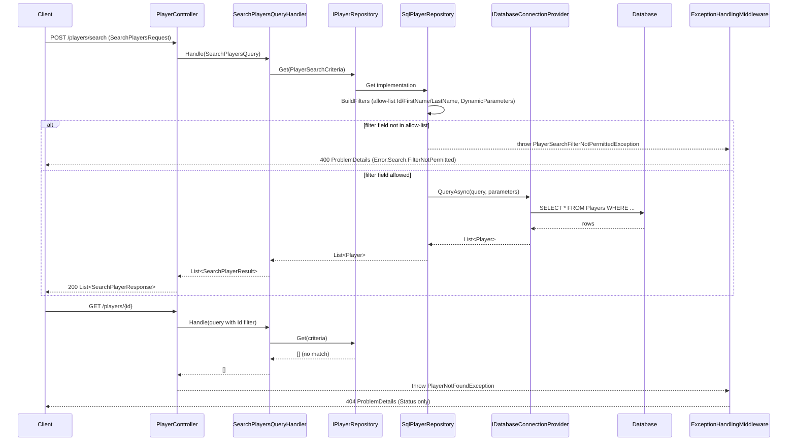

# Player Search and Persistence

## Overview

`SqlPlayerRepository.Get` builds a parameterized, allow-listed `WHERE` clause for `POST /api/v{version}/players/search` and `GET /api/v{version}/players/{id}` (the latter runs the search with a single `Id` filter). A filter field outside the allow-list throws `PlayerSearchFilterNotPermittedException`, mapped to `400 Bad Request`. An unknown player id ends the search with an empty result, and `PlayerController.GetBy` turns that into `PlayerNotFoundException`, mapped to a bare `404 Not Found`.

Related architecture: [`facility-crud.md`](../../../.github/doc/features/facility-crud.md) documents the equivalent allow-list pattern already used by `SqlFacilityRepository`, which this change now mirrors for `SqlPlayerRepository`.

## Sequence Diagram



## Methods & Properties Table

| Class | Member | Signature | Return | Description |
|---|---|---|---|---|
| `PlayerController` | `GetBy` | `Task<SearchPlayerResponse> GetBy(Guid id)` | `SearchPlayerResponse` | `GET /{id}`. Runs the search filtered by `Id`; throws `PlayerNotFoundException` when no row matches. |
| `PlayerController` | `Search` | `Task<List<SearchPlayerResponse>> Search(SearchPlayersRequest request)` | `List<SearchPlayerResponse>` | `POST /search`. Maps each `SearchPlayersFilter` (`Name`, `Value`) into a `QueryFilter` and delegates to `SearchPlayersQueryHandler`. |
| `SearchPlayersQueryHandler` | `Handle` | `Task<List<SearchPlayerResult>> Handle(SearchPlayersQuery, CancellationToken)` | `List<SearchPlayerResult>` | Builds `PlayerSearchCriteria` from the query filters and delegates to `IPlayerRepository.Get`. |
| `IPlayerRepository` | `Get` | `Task<List<Player>> Get(PlayerSearchCriteria, CancellationToken)` | `List<Player>` | Returns players matching the criteria, or an empty list if none match. |
| `SqlPlayerRepository` | `AllowedFilterColumns` | `IReadOnlyDictionary<string,string>` (`OrdinalIgnoreCase`) | — | Whitelist mapping the accepted filter names (`Id`, `FirstName`, `LastName`) to their canonical SQL column, matched case-insensitively. |
| `SqlPlayerRepository` | `Get` | `Task<List<Player>> Get(PlayerSearchCriteria, CancellationToken)` | `List<Player>` | Builds the `WHERE` clause via `BuildFilters`, then runs `SELECT * FROM \`Players\`` with `DynamicParameters` through `IDatabaseConnectionProvider.QueryAsync`. |
| `SqlPlayerRepository` | `BuildFilters` (private) | `(string whereClause, DynamicParameters parameters) BuildFilters(PlayerSearchCriteria)` | tuple | For each filter: rejects an unmapped/blank field name with `PlayerSearchFilterNotPermittedException` (no query is executed); otherwise appends `` `Column` = @pN `` using the canonical column name and binds the raw value as a Dapper parameter (never interpolated). |
| `PlayerSearchFilterNotPermittedException` | constructor | `PlayerSearchFilterNotPermittedException(string fieldName)` | — | Message `"FilterNotPermitted"`; carries the rejected `FieldName`. Declared in `Gaffer.Api/Shared/Repositories/IPlayerRepository.cs`. |
| `PlayerNotFoundException` | constructor | `PlayerNotFoundException(string message, Guid id)` | — | Thrown by `PlayerController.GetBy` when the search returns no row for the requested id. |
| `ExceptionToHttpResponseConverters` | `PlayerConverters[PlayerSearchFilterNotPermittedException]` | `Func<Exception, ProblemDetails>` | `ProblemDetails` | Maps to `400 Bad Request`, `Title = "Error.Search.FilterNotPermitted"`, `Detail = "FilterNotPermitted"`, `Extensions["ErrorTranslationKey"] = "Error.Search.FilterNotPermitted"`. Only this exact exception type is mapped, so `SqlFacilityRepository`'s own `ArgumentException` on an unknown filter is unaffected and still surfaces as an unmapped (500) error. |
| `ExceptionToHttpResponseConverters` | `PlayerConverters[PlayerNotFoundException]` / `BuildNotFoundProblemDetails` | `Func<Exception, ProblemDetails>` / `ProblemDetails BuildNotFoundProblemDetails()` | `ProblemDetails` | Maps to a bare `404 Not Found`: only `Status` is set (`Title`, `Detail`, `Type` remain `null`; no `Extensions` entry). `ExceptionHandlingMiddleware` still sets `Instance` to the request path afterward. |

## Dependencies

- `IPlayerRepository` / `SqlPlayerRepository` (Dapper-based, via `IDatabaseConnectionProvider`; see [`database-connection-lifecycle.md`](./database-connection-lifecycle.md)).
- `ExceptionToHttpResponseConverters.PlayerConverters` and `ExceptionHandlingMiddleware`, which serialize `ProblemDetails` with Newtonsoft.Json (PascalCase keys, `Extensions` nested object).
- `SearchPlayersQueryHandler` / `IQueryHandler<TQuery, TResult>` (CQRS pipeline), used by both `Search` and `GetBy`.

## Usage Examples

### HTTP: allowed filter

```http
POST /api/v1/players/search HTTP/1.1
Content-Type: application/json

{
  "filters": [
    { "name": "firstname", "value": "O'Neill" }
  ]
}
```

Returns `200 OK` with the matching players (field name matching is case-insensitive; a value containing a single quote is bound as a parameter, not concatenated into the SQL).

### HTTP: rejected filter field

```http
POST /api/v1/players/search HTTP/1.1
Content-Type: application/json

{
  "filters": [
    { "name": "Gender", "value": "Male" }
  ]
}
```

Returns `400 Bad Request`:

```json
{
  "Title": "Error.Search.FilterNotPermitted",
  "Detail": "FilterNotPermitted",
  "Status": 400,
  "Instance": "/api/v1/players/search",
  "Extensions": { "ErrorTranslationKey": "Error.Search.FilterNotPermitted" }
}
```

### HTTP: unknown player id

```http
GET /api/v1/players/00000000-0000-0000-0000-000000000000 HTTP/1.1
```

Returns `404 Not Found`:

```json
{
  "Status": 404,
  "Instance": "/api/v1/players/00000000-0000-0000-0000-000000000000"
}
```

### Repository call

```csharp
var criteria = new PlayerSearchCriteria
{
    criteriaList = [new SearchCriteria { Name = "FirstName", Value = "O'Neill" }]
};
List<Player> players = await playerRepository.Get(criteria, cancellationToken);
```
