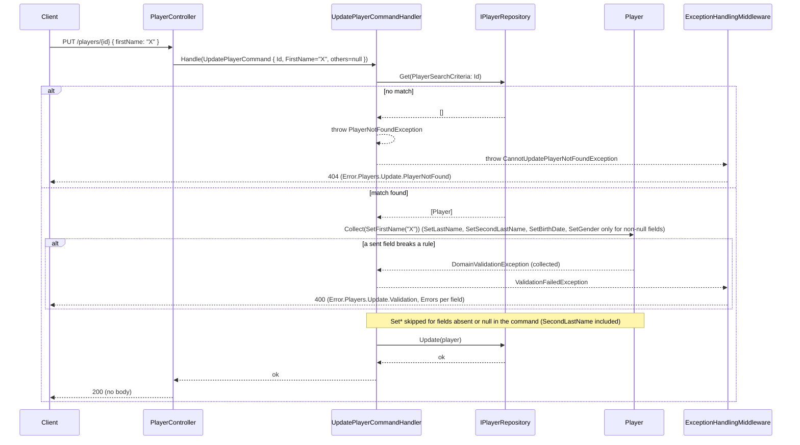

# Player Partial Update — Technical

## Overview

`PlayerController.Update` (`PUT /api/v{version}/players/{id}`) accepts `UpdatePlayerRequest`, whose optional fields (`FirstName`, `LastName`, `SecondLastName` as `string?`, `BirthDate` as `DateTime?`, `Gender` as `Gender?`) map 1:1 onto `UpdatePlayerCommand`, with no string parsing in the controller. `UpdatePlayerCommandHandler.Handle` loads the `Player` via `IPlayerRepository.Get` (same `Id`-filtered search as `PlayerController.GetBy`), applies only the fields present (non-null) in the command through the validating `Player.Set*` methods, and persists via `IPlayerRepository.Update`. Since TECHDEBT-005 `SecondLastName` follows the same rule as the rest: `null` is skipped (unchanged) and `""` or whitespace is rejected. Every sent field is applied inside `DomainValidationErrors.Collect`, and `ThrowIfAny` raises one `ValidationFailedException` (`Error.Players.Update.Validation`, `400`) before `IPlayerRepository.Update` runs, so nothing is saved if any field is invalid (see [`input-validation.md`](./input-validation.md)). An unknown id makes `GetPlayer` throw `PlayerNotFoundException`, caught and rethrown as `CannotUpdatePlayerNotFoundException` (mapped to `404`, before any body validation).

## Sequence Diagram



## Methods & Properties Table

| Class | Member | Signature | Return | Description |
|---|---|---|---|---|
| `PlayerController` | `Update` | `Task Update(Guid id, [FromBody] UpdatePlayerRequest request)` | `Task` | `PUT /{id}`. Builds `UpdatePlayerCommand` field-for-field from `request`, with no conversion (no `ToString()`/parsing). |
| `UpdatePlayerRequest` | properties | `string? FirstName/LastName/SecondLastName`, `DateTime? BirthDate`, `Gender? Gender` | — | All fields optional and nullable on the wire (Swagger 2.0: not in `RequiredProperties`, implicitly nullable per NJsonSchema semantics for that schema version). |
| `UpdatePlayerCommand` | properties | same shape as `UpdatePlayerRequest` | — | `ICommand`; carries `Id` plus the same five optional fields, untyped-to-typed conversion is not needed since both are already `DateTime?`/`Gender?`. |
| `UpdatePlayerCommandHandler` | `Handle` | `Task Handle(UpdatePlayerCommand, CancellationToken)` | `Task` | Loads the player, calls `UpdatePlayer`, persists via `IPlayerRepository.Update`. Converts `PlayerNotFoundException` into `CannotUpdatePlayerNotFoundException`; any other exception (e.g. a repository/infrastructure failure) propagates unchanged — see [`error-handling.md`](../error-handling.md). |
| `UpdatePlayerCommandHandler` | `UpdatePlayer` (private, static) | `void UpdatePlayer(Player, UpdatePlayerCommand)` | `void` | Each field is applied only if it is non-null (`BirthDate`/`Gender` only `if HasValue`) through `errors.Collect(() => player.Set*(...))`, `SecondLastName` included; `errors.ThrowIfAny()` then raises `ValidationFailedException("Cannot update player", Error.Players.Update.Validation, errors)`. An empty string is not skipped: it reaches the setter and is rejected. |
| `Player` | `SetSecondLastName` | `void SetSecondLastName(string newSecondLastName)` | `void` | Validating setter (required text rule, 1-100, not whitespace); throws `DomainValidationException`. `SetFirstName`, `SetLastName`, `SetBirthDate(DateTime, DateTime? todayUtc = null)` and `SetGender(Gender)` validate in the same way (rules in [`input-validation.md`](./input-validation.md)). The primary constructor (Dapper rehydration) does not validate. |
| `Player` | `SetBirthDate` (overload) | `void SetBirthDate(DateTime newBirthDate)` | `void` | Typed overload used by the handler; renamed from `SetBirthDateName(DateTime)` (TECHDEBT-003). The `string`-typed overload was likewise renamed to `SetBirthDate(string newBirthDate)`, and the getter to `GetBirthDate()` (from `SetBirthDateName`/`GetBirthDateName`), used elsewhere (`PlayerShould`). `GetGenderName`/`SetGender(string)` keep their names — `GetGenderName` returns the enum member's name, which is already correct. |
| `Player` | `SetGender` (overload) | `void SetGender(Gender gender)` | `void` | Typed overload used by the handler; the pre-existing `SetGender(string)` overload remains. |
| `CannotUpdatePlayerNotFoundException` | constructor | `CannotUpdatePlayerNotFoundException(string message, Guid id)` | — | Mapped to `404`, `Error.Players.Update.PlayerNotFound` (see [`error-handling.md`](../error-handling.md) for the full converter table). |

## Dependencies

- Validation: `Player` setters, `DomainValidationErrors` and `ValidationFailedException` (`400`, `Error.Players.Update.Validation`): [`input-validation.md`](./input-validation.md).
- `IPlayerRepository` / `SqlPlayerRepository` for both the lookup and the persisted update (see [`player-search-and-persistence.md`](./player-search-and-persistence.md) for the lookup side and [`database-connection-lifecycle.md`](./database-connection-lifecycle.md) for the per-request connection it uses).
- `ExceptionToHttpResponseConverters` / `ExceptionHandlingMiddleware` for the `404` mapping and, for any non-`PlayerNotFoundException` failure surfacing from this handler, the `500` unmapped-exception path — both described in [`error-handling.md`](../error-handling.md) and its technical counterpart.
- OpenAPI contract: `Gaffer.Api/nswag.json` generates `Gaffer.Api.Client` from the now-optional/nullable `birthDate`/`gender` request schema; regenerating the client after this change is the operator's responsibility (see [`api-client-versioning.md`](./api-client-versioning.md) for whether this is a MINOR or MAJOR bump — the schema relaxation itself is backward-compatible, and TECHDEBT-005 changed the behaviour of `secondLastName` (no longer cleared when omitted or null; `""` is a `400`) without changing the schema, so the served OpenAPI and the generated client were identical before and after; the change is still worth calling out when bumping).

## Usage Examples

### Partial update: only one field changes

```http
PUT /api/v1/players/75d5... HTTP/1.1
Content-Type: application/json

{ "firstName": "Alexia" }
```

Result: `firstName` changes; `lastName`, `birthDate`, `gender` are unchanged; `secondLastName` is unchanged (it was not sent).

### Explicit null on birthDate/gender is a no-op for those fields

```http
PUT /api/v1/players/75d5... HTTP/1.1
Content-Type: application/json

{ "birthDate": null, "gender": null }
```

Result: `birthDate` and `gender` keep their previous values; `secondLastName` is unchanged too.

### Replacing secondLastName explicitly

```http
PUT /api/v1/players/75d5... HTTP/1.1
Content-Type: application/json

{ "secondLastName": "Segura" }
```

Result: only `secondLastName` changes, to `"Segura"`; every other field keeps its previous value.

### Invalid values (400)

```http
PUT /api/v1/players/75d5... HTTP/1.1
Content-Type: application/json

{ "firstName": "", "secondLastName": "" }
```

Returns `400`, `errorTranslationKey = "Error.Players.Update.Validation"`, `errors` with `firstName` and `secondLastName`; nothing is saved. Sending only `{ "firstName": "X" }` leaves `secondLastName` as it was.

### Unknown id

```http
PUT /api/v1/players/00000000-0000-0000-0000-000000000000 HTTP/1.1
Content-Type: application/json

{ "firstName": "X" }
```

Returns `404 Not Found` with `errorTranslationKey = "Error.Players.Update.PlayerNotFound"`.

## How to test

- `Gaffer.Api.Tests/Acceptance/PlayerFeaturesShould.cs`: `UpdateAPlayer`, `KeepBirthDateAndGenderWhenUpdatedWithExplicitNulls`, `UpdateEveryFieldWhenAllFieldsAreSent`, `ReplaceTheSecondLastNameOnlyWhenAValueIsSent`, `RejectAPartialUpdateWithAnInvalidFieldAndChangeNothing`, `KeepThePlayerIdenticalWhenUpdatedWithAnEmptyBody`, `ReturnNotFoundWhenUpdatingAnUnknownPlayerWithAnInvalidBody`, `ReportEveryInvalidFieldOfAPartialUpdate`, `ReturnNotFoundWhenUpdatingAnUnknownPlayer`.
- `Gaffer.Api.Tests/Unit/Commands/UpdatePlayerCommandHandlerShould.cs`: field-by-field application rules (`KeepOmittedFieldsIncludingTheSecondLastNameWhenOnlyFirstNameIsSent`, `RejectAnEmptySecondLastNameWithoutUpdating`, `ReportEverySentInvalidFieldAndNotUpdateWhenAnyIsInvalid`, `ReturnNotFoundBeforeValidatingTheSentFields`, `UpdateAStoredPlayerThatBreaksTheRulesWhenOnlyValidFieldsAreSent`) and the `PlayerNotFoundException` → `CannotUpdatePlayerNotFoundException` conversion.
- `Gaffer.Api.Tests/Acceptance/OpenApiContractShould.cs`: `DeclareUpdatePlayerRequestFieldAsOptionalAndNullable` — asserts `birthDate`/`gender` are absent from `RequiredProperties` and nullable per the served Swagger 2.0 document.
- Run with `dotnet test gaffer-api.sln` against the Docker MySQL database (see [`database-configuration.md`](./database-configuration.md)).
